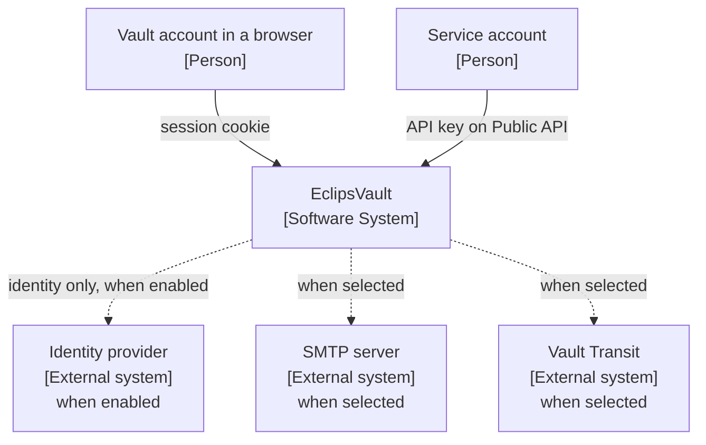
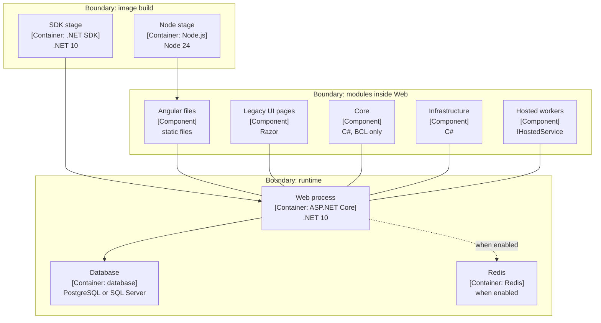
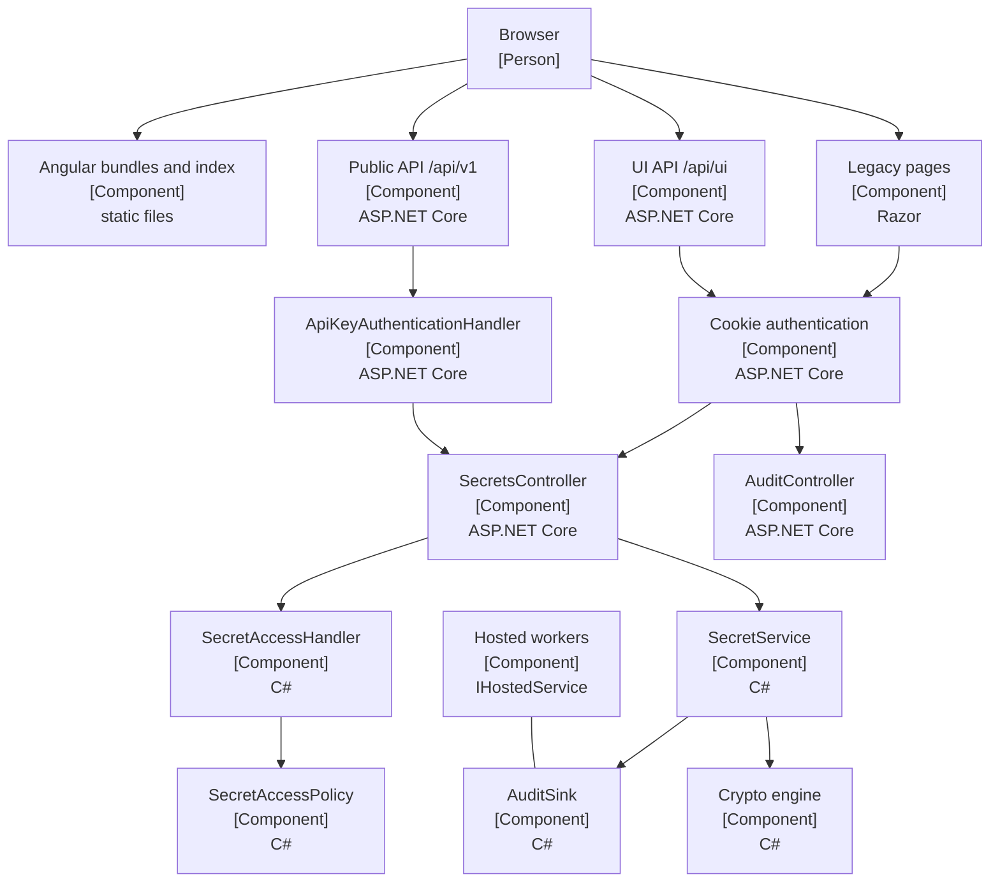
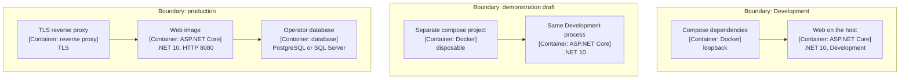

# Diagrams / დიაგრამები

These are C4 views of the revision named in each table. Every box names its C4 type in brackets.
A container box is `[Container: technology]` plus a short technology line. A component box is
`[Component]` plus a short technology line. People, the software system, and external systems carry
the type only.

**Current** is `origin/main` at `0bb59de1e8f64d1b7d04468c303c1b108dd6f04b`. **Same on Area 6a** means
the named file has no diff against `ab7997e14ba98fd37055e6ca77fab4c6c8aba490`. **Planned** is not
drawn as a box that exists.

Core and Infrastructure are components inside the Web process, never containers. Node is a build
container, not a runtime container. The database and Redis are containers inside the system: they
appear in section 2 and not in the context picture.

The rendered pages are [diagrams.html](diagrams.html) and the files in [svg/](svg/). Regenerate
them with `npm run render` in [render/](render/).

## 1. Context

Who is outside the vault. EclipsVault is one software system in the centre. The database and Redis
are inside that system, so they are not drawn here.



Caption / წარწერა: EclipsVault is one software system. A person uses a session, a service account
uses an API key, and the three external systems exist only when that integration is configured. /
EclipsVault ერთი პროგრამული სისტემაა. ადამიანი სესიას იყენებს, სერვისის ანგარიში API გასაღებს,
და სამი გარე სისტემა მხოლოდ მაშინ არსებობს, როცა ეს ინტეგრაცია კონფიგურირებულია.

| Element | Source at `0bb59de` | State |
|---|---|---|
| Vault account in a browser `[Person]` | `CONTEXT.md` vault account, session, second factor | current vocabulary |
| Service account `[Person]` | `CONTEXT.md` service account, API key | current vocabulary |
| EclipsVault `[Software System]` | ADR-0008: one origin, one process serves the UI and both APIs | current |
| Session-cookie edge | ADR-0002; `Program.cs` cookie `EclipsVault.Session` | current, same on Area 6a |
| Person to the system | `AccountController.Login` then `SessionIssuer.SignInAsync` | current |
| Service account to the Public API | `SecretsApiController` route `api/v1/secrets`; `ApiKeyAuthenticationHandler` | current |
| Identity provider `[External system]`, when enabled | `Program.cs` wires OpenID Connect only when `SsoOptions.Enabled`; ADR-0002: the IdP proves identity and the vault decides admission | current |
| SMTP server `[External system]`, when selected | `DependencyInjection` uses `SmtpEmailSender` only when `Email:Sender` is `Smtp`; committed default in `appsettings.json` is `Log` | current |
| Vault Transit `[External system]`, when selected | `appsettings.json` `Crypto:Engine` is `AesGcmLocal`; `VaultTransitCryptoEngine` is used when the engine is `VaultTransit` | current |
| Angular is not its own system | ADR-0008 | current. Not a box in this picture |
| Database and Redis | Drawn in section 2. `DependencyInjection` selects one `Database:Provider`. `appsettings.json` sets `Redis:Enabled` false | current. Not boxes in this picture |

## 2. Container

Containers inside the one system, plus the build containers that produce the Web image. The groups
are boundaries, not extra systems. The production image runs one application container.



Caption / წარწერა: Node and the SDK exist while the image is built. At runtime there is the Web
container, the one selected database, and Redis only when it is enabled. Core and Infrastructure
stay modules inside Web. / Node და SDK იმიჯის აწყობისას არსებობს. გაშვებისას არის Web კონტეინერი,
ერთი არჩეული ბაზა, და Redis მხოლოდ მაშინ, როცა ჩართულია. Core და Infrastructure Web-ის შიგნით
მოდულებად რჩება.

| Element | Source at `0bb59de` | State |
|---|---|---|
| Node stage `[Container: Node.js]` | `Dockerfile` `FROM node:24.22.0-bookworm-slim … AS ui`, `npm run build` | current, same on Area 6a |
| SDK stage `[Container: .NET SDK]` | `Dockerfile` `AS build`, `dotnet publish` | current, same on Area 6a |
| Web process `[Container: ASP.NET Core]` | `Dockerfile` `AS runtime`, `ENTRYPOINT` `EclipsVault.Web.dll` | current, same on Area 6a |
| Angular files `[Component]` | `Dockerfile` copies `wwwroot/ui` and `AngularUi` from the `ui` stage; ADR-0008 | current, same on Area 6a |
| Web serves Angular from its own origin | ADR-0008; `AngularUiRoutes.MapAngularUi` | current |
| Legacy pages `[Component]` | `AngularUiRoutes` path list has no `/Secrets` details and no `/Audit` | current on `main`. Area 6a adds Encryption keys routes; not merged |
| Core `[Component]` | `EclipsVault.Core.csproj` has no packages; `EclipsVault.Web.csproj` references it | current |
| Infrastructure `[Component]` | `EclipsVault.Infrastructure.csproj` references Core; Web references Infrastructure | current |
| Database `[Container: database]`, PostgreSQL or SQL Server | `DependencyInjection` reads `Database:Provider` once; `DatabaseProvider.UseVaultDatabase` | current, same on Area 6a |
| Redis `[Container: Redis]`, when enabled | `appsettings.json` `Redis:Enabled` false; `DependencyInjection` registers Redis implementations only when it is true | current |
| PostgreSQL migrations assembly loaded by Web | `EclipsVault.Web.csproj` references `EclipsVault.Migrations.Postgres` | current |
| Postgres migrations reference Infrastructure | `EclipsVault.Migrations.Postgres.csproj` | current |
| Hosted workers `[Component]` | `Program.cs` `AddHostedService` for `SecretLifecycleWorker`, `DynamicLeaseWorker`, `LicenseStartupCheck`; `DependencyInjection` hosts `AuditGroupCommitter` | current, same registration site on Area 6a for these four |
| Offline verifier is not this picture | `EclipsVault.AuditVerifier.csproj` references Core only | current; a separate tool, not a vault container |
| Development dependencies are not this runtime | `docker-compose.yml` header: local development only, dependencies, not a deployment | current, same on Area 6a |

`docker-compose.yml` does not run Web. ADR-0008 says the compose file is unaffected and runs only
the dependencies. The process beside it is `dotnet run --project EclipsVault.Web`, from the README.

## 3. Web component

The pieces inside the Web container that the talk touches. Controllers stay thin; the access rule
lives in Core.



Caption / წარწერა: the same access policy serves a session and an API key. The audit page is a
Legacy administrator page on this revision. / ერთი და იგივე წვდომის წესი ემსახურება სესიასაც და
API გასაღებსაც. ამ რევიზიაზე აუდიტის გვერდი Legacy ადმინისტრატორის გვერდია.

| Element | Source at `0bb59de` | State |
|---|---|---|
| Browser `[Person]` | ADR-0002: the browser holds the session cookie and no access token | current |
| Angular bundles and index `[Component]` | `AngularUiRoutes`: document outside `wwwroot`, bundles under `wwwroot/ui` | current |
| Route table, session or `AdminOnly` | `AngularUiRoutes.Paths` and `administratorPaths` | current. `/Audit` is not in the list |
| UI API and Public API `[Component]` | ADR-0005: neither accepts the other's credential | current |
| UI API problem responses | ADR-0006; `Program.cs` `MapFallback("/api/ui/{**path}")` | current |
| Cookie authentication `[Component]` | `Program.cs` `EclipsVault.Session`, `EclipsVault.MfaPending`, `HttpOnly`, `Secure`, `SameSite=Strict` | current, same on Area 6a |
| `ApiKeyAuthenticationHandler` `[Component]` | `ApiKeyAuthenticationHandler` | current |
| `SecretsController` `[Component]` | `SecretsController` | current |
| `SecretAccessHandler` and `SecretAccessPolicy` `[Component]` | `SecretAccessHandler` delegates to `SecretAccessPolicy` | current |
| `SecretService` `[Component]` | `SecretService` | current, same on Area 6a |
| `AuditSink` `[Component]` | `AuditSink`; `AuditGroupCommitter` | current |
| Crypto engine `[Component]` | `CryptoEngineFactory`; `AesGcmCryptoEngine`; `VaultTransitCryptoEngine` | current |
| `AuditController` `[Component]` | `AuditController` with `VaultPolicies.AdminOnly` | current. Area 6b plans an Angular page; not built |
| Hosted workers `[Component]` | `Program.cs` and `DependencyInjection` as in the container table | current |
| Server decides what the UI may show | ADR-0012 | current |
| Browser to Angular files | `Program.cs` `UseStaticFiles`; `AngularUiRoutes.ServeIndex` | current |
| Browser to Legacy pages | `Program.cs` default controller route; paths absent from `AngularUiRoutes` | current |
| Legacy and UI API through the session cookie | `Program.cs` cookie scheme; ADR-0002 | current |
| Public API through the API key handler | `SecretsApiController` `[Authorize(AuthenticationSchemes = AuthSchemes.ApiKey)]` | current |
| Secrets controller to handler, handler to policy | `SecretsController.CheckAccessAsync`; `SecretAccessHandler` | current |
| Secrets controller to `SecretService`, then sink and engine | `SecretService.RevealAsync` | current, same on Area 6a |
| Session to audit page | `AuditController` `AdminOnly` | current |
| Hosted committer to the sink | `DependencyInjection` hosts `AuditGroupCommitter`; `AuditSink` waits on it | current |

## 4. Focused code: reveal

Success path for an Internal secret that does not need step-up. This is the talk's secret. Each
participant is a component of that path, except the browser, which is the person.

```mermaid
sequenceDiagram
  participant Browser as Browser<br/>[Person]
  participant Controller as SecretsController.Reveal<br/>[Component]<br/>ASP.NET Core
  participant Details as SecretService.GetDetailsAsync<br/>[Component]<br/>C#
  participant Access as SecretAccessHandler<br/>[Component]<br/>C#
  participant Policy as SecretAccessPolicy<br/>[Component]<br/>C#
  participant Reveal as SecretService.RevealAsync<br/>[Component]<br/>C#
  participant Sink as AuditSink<br/>[Component]<br/>C#
  participant Crypto as ICryptoEngine.UnsealAsync<br/>[Component]<br/>C#

  Browser->>Controller: POST reveal
  Controller->>Details: load envelope
  Details->>Sink: commit Viewed
  Controller->>Access: CheckAccessAsync
  Access->>Policy: Evaluate
  Policy-->>Access: allow
  Access-->>Controller: allow
  Controller->>Reveal: RevealAsync
  Reveal->>Sink: commit SecretRevealed
  Sink-->>Reveal: committed
  Reveal->>Crypto: unwrap data key and open value
  Crypto-->>Browser: plaintext in the page
```

Caption / წარწერა: `SecretRevealed` is committed before `UnsealAsync`. The earlier `Viewed` row is
the details load, and it is written before the access decision. / `SecretRevealed` ფიქსირდება
`UnsealAsync`-მდე. უფრო ადრეული `Viewed` დეტალების ჩატვირთვაა და წვდომის გადაწყვეტამდე იწერება.

| Element | Source at `0bb59de` | State |
|---|---|---|
| Browser `[Person]` | `VaultController` `[Authorize(Policy = VaultPolicies.Session)]` | current |
| `SecretsController.Reveal` `[Component]` | `SecretsController.Reveal` calls `GetDetailsAsync` then `CheckAccessAsync` | current, same on Area 6a |
| `GetDetailsAsync` `[Component]` | `SecretService.GetDetailsAsync` audits `SecretMetadataViewed` | current, same on Area 6a |
| Label `Viewed` | `AuditDisplay` | current |
| `SecretAccessHandler` and `SecretAccessPolicy` `[Component]` | `SecretsController.CheckAccessAsync`; `SecretAccessPolicy.Evaluate` | current |
| Denial redirects and does not call `RevealAsync` | `CheckAccessAsync` returns a redirect | current |
| Step-up skipped below Secret | `appsettings.json` `StepUp:MinimumSensitivity` `Secret`; `SecretsController.Reveal` | current |
| `RevealAsync` then `AuditSink` `[Component]` | `SecretService.RevealAsync` awaits `AuditSink` before `DecryptToDtoAsync` | current, same on Area 6a |
| Sink waits for commit | `AuditSink` | current |
| Failure type | `AuditWriteFailedException` from `AuditSink` | current. Area 6a touches the exception file; the reveal call order does not change |
| `UnsealAsync` `[Component]` | `AesGcmCryptoEngine.UnsealAsync` unwraps the data key with the master key, then opens the payload | current |
| Screen label `Revealed` | `AuditDisplay` for `AuditAction.SecretRevealed` | current |
| Plaintext reaches the browser after success | `SecretsController.Reveal` returns the details view with `revealed.Value` | current. Do not record that screen |

Honey-token trips are not in this sequence. `GetDetailsAsync` and `RevealAsync` call
`TripHoneyTokenIfNeededAsync` before their audit write. The talk never uses that path. The decoy
names are in the demo draft so they can be avoided.

## 5. Deployment

Three ways to run the same Web container. Only Development and production are repository deployment
descriptions. The demonstration is a proposed disposable use of Development. It was not launched.
The groups are boundaries between those descriptions.



Caption / წარწერა: the middle boundary reuses Development. It is not a third product mode, and this
draft did not start it. / შუა საზღვარი Development-ს იყენებს. ის მესამე პროდუქტის რეჟიმი არ არის და
ამ მონახაზმა ის არ გაუშვა.

| Element | Source at `0bb59de` | State |
|---|---|---|
| Compose dependencies `[Container: Docker]` | `docker-compose.yml` header: laptop, public dev passwords, no TLS, loopback ports | current, same on Area 6a |
| Compose services behind that container | `docker-compose.yml` service names `db`, `vault`, `mailpit`, `redis`, `keycloak` | current. Present does not mean the process uses them |
| Web on the host `[Container: ASP.NET Core]` | `README.md` `dotnet run --project EclipsVault.Web`; Web is not a compose service; ADR-0008 | current |
| Development seeds the demo world | `DbSeeder.SeedDevelopmentDataAsync`, called only when the host is Development | current |
| Development applies migrations | `DatabaseMigrator` `environment.IsDevelopment()` | current |
| Separate compose project and demonstration process | [demo-setup-reset.md](demo-setup-reset.md) | draft procedure, not executed |
| TLS reverse proxy `[Container: reverse proxy]` | `docs/INSTALL.md`: TLS terminates at a proxy; the image serves plain HTTP | current |
| Web image `[Container: ASP.NET Core]` | `Dockerfile` `ASPNETCORE_HTTP_PORTS=8080`; `docs/INSTALL.md` | current |
| Operator database `[Container: database]`, PostgreSQL or SQL Server | `docs/INSTALL.md` section 2: least-privilege login, TLS on the connection | current. Values are the operator's, not in this draft |
| Production bootstraps one administrator and no sample secrets | `DbSeeder` production path; `DbSeederTests` names that behaviour | current |
| Production does not migrate unless `Database:MigrateOnStartup` | `DatabaseMigrator`; `docs/INSTALL.md` | current |
| Production provider, connection, KEK, audit signing key, key ring | `docs/INSTALL.md` section 2 | current. Values are the operator's, not in this draft |
| Browser end-to-end stack | `AGENTS.md` browser section: production image, SQL Server, Redis, SMTP capture, TLS proxy | a test harness, not the talk and not production |

The end-to-end harness is omitted from the picture so it is not mistaken for the demonstration.
It is a fourth shape, used by Playwright, and it was not started.
