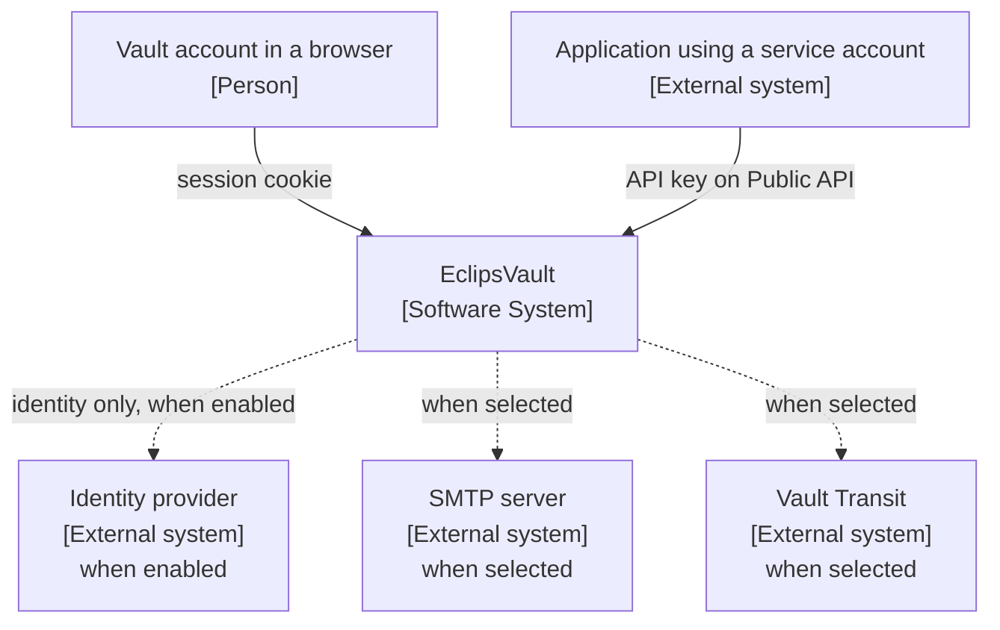
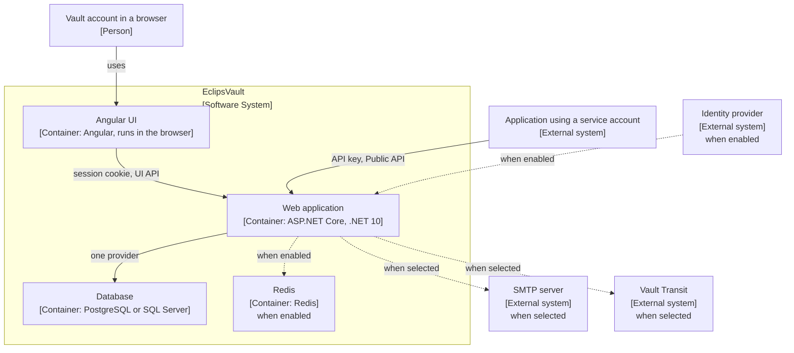
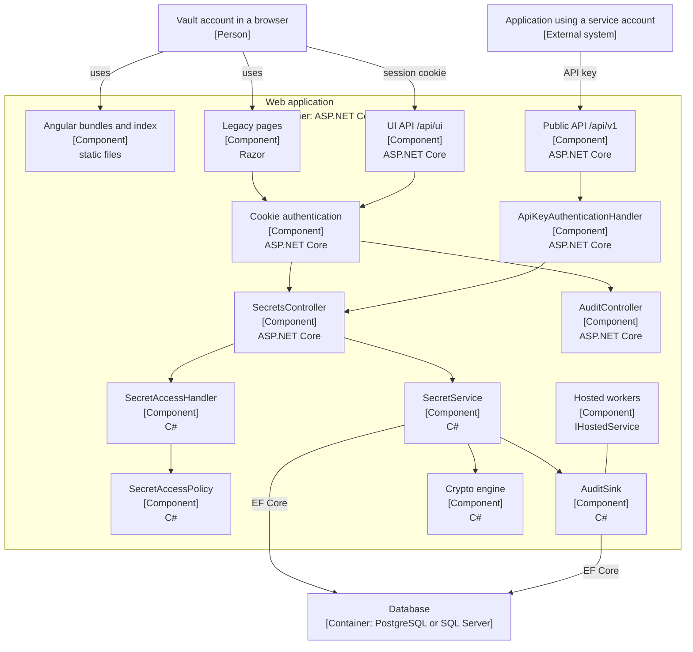

# Diagrams / დიაგრამები

These are C4 views of the revision named in each table. Every box names its C4 type in brackets.
A container box is `[Container: technology]` plus a short technology line. A component box is
`[Component]` plus a short technology line. People, the software system, and external systems carry
the type only.

**Current** is `origin/main` at `0bb59de1e8f64d1b7d04468c303c1b108dd6f04b`. **Same on Area 6a** means
the named file has no diff against `ab7997e14ba98fd37055e6ca77fab4c6c8aba490`. **Planned** is not
drawn as a box that exists.

The Angular UI is a container that runs in the browser; section 2 draws it. Core and
Infrastructure are components inside the Web application, drawn in section 3, not containers of
their own. Node and the .NET SDK build the image and are not runtime containers; section 5 names
them and does not draw them. The database and Redis are runtime containers in section 2, not in
the context picture.

The rendered pages are [diagrams.html](diagrams.html) and the files in [svg/](svg/). Regenerate
them with `npm run render` in [render/](render/).

## 1. Context

Who is outside the vault. EclipsVault is one software system in the centre. The database and Redis
are inside that system, so they are not drawn here.



Caption / წარწერა: EclipsVault is one software system. A vault account in a browser is a person and
uses a session. An application that uses a service account is an external system and calls the
Public API with an API key. The identity provider, SMTP, and Vault Transit exist only when that
integration is configured. / EclipsVault ერთი პროგრამული სისტემაა. ბრაუზერში მყოფი საცავის
ანგარიში პიროვნებაა და სესიას იყენებს. აპლიკაცია, რომელიც სერვისის ანგარიშს იყენებს, გარე
სისტემაა და საჯარო API-ს API გასაღებით იძახებს. იდენტობის მომწოდებელი, SMTP და Vault Transit
მხოლოდ მაშინ არსებობენ, როცა ეს ინტეგრაცია კონფიგურირებულია.

| Element | Source at `0bb59de` | State |
|---|---|---|
| Vault account in a browser `[Person]` | `CONTEXT.md` vault account, session, second factor | current vocabulary |
| Application using a service account `[External system]` | `CONTEXT.md`: a service account is a non-interactive identity for an application. It never has a session | current vocabulary |
| EclipsVault `[Software System]` | ADR-0008: one origin, one process serves the UI and both APIs | current |
| Session-cookie edge | ADR-0002; `Program.cs` cookie `EclipsVault.Session` | current, same on Area 6a |
| Person to the system | `AccountController.Login` then `SessionIssuer.SignInAsync` | current |
| That application to the Public API | `SecretsApiController` route `api/v1/secrets`; `ApiKeyAuthenticationHandler` | current |
| Identity provider `[External system]`, when enabled | `Program.cs` wires OpenID Connect only when `SsoOptions.Enabled`; ADR-0002: the IdP proves identity and the vault decides admission | current |
| SMTP server `[External system]`, when selected | `DependencyInjection` uses `SmtpEmailSender` only when `Email:Sender` is `Smtp`; committed default in `appsettings.json` is `Log` | current |
| Vault Transit `[External system]`, when selected | `appsettings.json` `Crypto:Engine` is `AesGcmLocal`; `VaultTransitCryptoEngine` is used when the engine is `VaultTransit` | current |
| Angular UI, not a second software system | ADR-0008: Web serves it from the same origin. It is a container inside this system, drawn in section 2 | current. Not a box in this picture |
| Database and Redis | Drawn in section 2. `DependencyInjection` selects one `Database:Provider`. `appsettings.json` sets `Redis:Enabled` false | current. Not boxes in this picture |

## 2. Container

Runtime containers inside the one software system. The people and external systems from section 1
stay outside the boundary. Image-build stages are not runtime containers; section 5 names them and
does not draw them. Core, Infrastructure, the Legacy pages, and the hosted workers are components
of the Web application; section 3 draws those.



Caption / წარწერა: The Angular UI, the Web application, and one database are runtime containers.
Redis is a fourth container only when it is enabled. The Angular UI runs in the browser and calls
the UI API with the session cookie. The Web application serves the Angular files, the UI API, the
Public API, and the Legacy pages that remain. The person and the external systems stay outside the
boundary. / Angular UI, Web აპლიკაცია და ერთი ბაზა გაშვების კონტეინერებია. Redis მეოთხე
კონტეინერია მხოლოდ მაშინ, როცა ჩართულია. Angular UI ბრაუზერში ეშვება და UI API-ს სესიის ქუქით
იძახებს. Web აპლიკაცია Angular-ის ფაილებს, UI API-ს, საჯარო API-ს და დარჩენილ Legacy გვერდებს
აწვდის. პიროვნება და გარე სისტემები საზღვრის გარეთ რჩებიან.

| Element | Source at `0bb59de` | State |
|---|---|---|
| Vault account in a browser `[Person]` | `CONTEXT.md` vault account; outside the system boundary | current vocabulary |
| Application using a service account `[External system]` | `CONTEXT.md` service account; outside the system boundary | current vocabulary |
| Identity provider, SMTP server, Vault Transit | Same configuration gates as section 1. Each arrow ends at the Web application, which is the container that calls them | current |
| EclipsVault `[Software System]` boundary | ADR-0008: one system, one origin | current |
| Angular UI `[Container: Angular, runs in the browser]` | ADR-0008 and `Dockerfile` `ui` stage: the built files run in the browser. `AngularUiRoutes` serves the document from Web | current |
| Arrow from Angular UI to Web, session cookie and UI API | ADR-0002; ADR-0005; `Program.cs` cookie `EclipsVault.Session` | current, same on Area 6a |
| Web application `[Container: ASP.NET Core, .NET 10]` | `Dockerfile` runtime stage, `ENTRYPOINT` `EclipsVault.Web.dll`. It serves the Angular files, `/api/ui/`, `/api/v1/`, and the Legacy pages still absent from `AngularUiRoutes` | current, same on Area 6a |
| Database `[Container: PostgreSQL or SQL Server]` | `DependencyInjection` reads `Database:Provider` once; `DatabaseProvider.UseVaultDatabase` | current, same on Area 6a |
| Redis `[Container: Redis]`, when enabled | `appsettings.json` `Redis:Enabled` false; `DependencyInjection` registers Redis implementations only when it is true | current |
| Core, Infrastructure, Legacy pages, hosted workers | Not boxes here. Section 3 draws them inside the Web application | current |
| Node and .NET SDK build stages | Not boxes here. `Dockerfile` stages `ui` and `build`. Section 5 records them as image build, not runtime | current, same on Area 6a |

## 3. Web component

Components inside the Web application container from section 2. The vault account reaches the
Angular files, the Legacy pages, and the UI API from outside. An application that uses a service
account is the only caller of the Public API. The database stays outside the boundary.
SecretService and AuditSink reach it through EF Core. Controllers stay thin; the access rule
lives in Core.



Caption / წარწერა: The vault account reaches the Angular files, the Legacy pages, and the UI API.
Only an application that uses a service account calls the Public API. SecretService and AuditSink
persist through EF Core to the database outside the Web application. / საცავის ანგარიში აღწევს
Angular-ის ფაილებს, Legacy გვერდებს და UI API-ს. საჯარო API-ს მხოლოდ ის აპლიკაცია იძახებს,
რომელიც სერვისის ანგარიშს იყენებს. SecretService და AuditSink მონაცემებს EF Core-ით წერენ ბაზაში,
რომელიც Web აპლიკაციის გარეთ დგას.

| Element | Source at `0bb59de` | State |
|---|---|---|
| Vault account in a browser `[Person]` | `CONTEXT.md` vault account; ADR-0002: the browser holds the session cookie and no access token | current |
| Angular bundles and index `[Component]` | `AngularUiRoutes`: document outside `wwwroot`, bundles under `wwwroot/ui`. These are files the section 2 Angular UI container loads | current |
| Route table, session or `AdminOnly` | `AngularUiRoutes.Paths` and `administratorPaths` | current. `/Audit` is not in the list |
| UI API and Public API `[Component]` | ADR-0005: neither accepts the other's credential | current |
| UI API problem responses | ADR-0006; `Program.cs` `MapFallback("/api/ui/{**path}")` | current |
| Cookie authentication `[Component]` | `Program.cs` `EclipsVault.Session`, `EclipsVault.MfaPending`, `HttpOnly`, `Secure`, `SameSite=Strict` | current, same on Area 6a |
| `ApiKeyAuthenticationHandler` `[Component]` | `ApiKeyAuthenticationHandler` | current |
| `SecretsController` `[Component]` | `SecretsController` | current |
| `SecretAccessHandler` and `SecretAccessPolicy` `[Component]` | `SecretAccessHandler` delegates to `SecretAccessPolicy` | current |
| `SecretService` `[Component]` | `SecretService` | current, same on Area 6a |
| `AuditSink` `[Component]` | `AuditSink`; `AuditGroupCommitter` | current |
| Crypto engine `[Component]` | `CryptoEngineFactory`; `AesGcmCryptoEngine`; `VaultTransitCryptoEngine` | current |
| `AuditController` `[Component]` | `AuditController` with `VaultPolicies.AdminOnly` | current. Area 6b plans an Angular page; not built |
| Hosted workers `[Component]` | `Program.cs` registers `SecretLifecycleWorker`, `DynamicLeaseWorker`, and `LicenseStartupCheck`; `DependencyInjection` hosts `AuditGroupCommitter`. Threads in the Web application, not containers | current |
| Server decides what the UI may show | ADR-0012 | current |
| Web application boundary `[Container: ASP.NET Core, .NET 10]` | Same container as section 2. The components below are inside it | current |
| Vault account to Angular files, Legacy pages, and the UI API | `Program.cs` `UseStaticFiles`; `AngularUiRoutes.ServeIndex`; default controller route for paths absent from `AngularUiRoutes`. No arrow to the Public API | current |
| Legacy pages and the UI API through the session cookie | `Program.cs` cookie scheme; ADR-0002 | current |
| Application using a service account `[External system]` | `CONTEXT.md` service account. The only caller of `Public API /api/v1` in this picture | current |
| Public API through the API key handler | `SecretsApiController` `[Authorize(AuthenticationSchemes = AuthSchemes.ApiKey)]`; ADR-0005 | current |
| Database `[Container: PostgreSQL or SQL Server]`, outside Web | `DependencyInjection` `AddDbContext`; `DatabaseProvider.UseVaultDatabase`. Same container as section 2 | current, same on Area 6a |
| SecretService and AuditSink to the database, EF Core | `SecretService` writes through its repository; `AuditSink` commits through `AuditGroupCommitter`. Both use the EF Core `EclipsVaultDbContext` | current |
| Secrets controller to handler, handler to policy | `SecretsController.CheckAccessAsync`; `SecretAccessHandler` | current |
| Secrets controller to `SecretService`, then sink and engine | `SecretService.RevealAsync` | current, same on Area 6a |
| Session to audit page | `AuditController` `AdminOnly` | current |
| Hosted committer to the sink | `DependencyInjection` hosts `AuditGroupCommitter`; `AuditSink` waits on it | current |

## 4. Focused code: reveal

Success path for an Internal secret that does not need step-up. This is the talk's secret. Each
participant is a component of that path, except the vault account, which is the person. In a
sequence diagram `#` starts a comment, so the technology line is written `C#35;`, which renders
as `C#`.

```mermaid
sequenceDiagram
  participant Account as Vault account in a browser<br/>[Person]
  participant Controller as SecretsController.Reveal<br/>[Component]<br/>ASP.NET Core
  participant Details as SecretService.GetDetailsAsync<br/>[Component]<br/>C#35;
  participant Access as SecretAccessHandler<br/>[Component]<br/>C#35;
  participant Policy as SecretAccessPolicy<br/>[Component]<br/>C#35;
  participant Reveal as SecretService.RevealAsync<br/>[Component]<br/>C#35;
  participant Sink as AuditSink<br/>[Component]<br/>C#35;
  participant Crypto as ICryptoEngine.UnsealAsync<br/>[Component]<br/>C#35;

  Account->>Controller: POST reveal
  Controller->>Details: load envelope
  Details->>Sink: commit Viewed
  Controller->>Access: CheckAccessAsync
  Access->>Policy: Evaluate
  Policy-->>Access: allow
  Access-->>Controller: allow
  Controller->>Reveal: RevealAsync
  Reveal->>Sink: commit SecretRevealed
  Sink-->>Reveal: committed
  Reveal->>Crypto: unwrap data key and open value
  Crypto-->>Account: plaintext in the page
```

Caption / წარწერა: `SecretRevealed` is committed before `UnsealAsync`. The earlier `Viewed` row is
the details load, and it is written before the access decision. / `SecretRevealed` ფიქსირდება
`UnsealAsync`-მდე. უფრო ადრეული `Viewed` დეტალების ჩატვირთვაა და წვდომის გადაწყვეტამდე იწერება.

| Element | Source at `0bb59de` | State |
|---|---|---|
| Vault account in a browser `[Person]` | `CONTEXT.md` vault account; `VaultController` `[Authorize(Policy = VaultPolicies.Session)]` | current |
| `SecretsController.Reveal` `[Component]` | `SecretsController.Reveal` calls `GetDetailsAsync` then `CheckAccessAsync` | current, same on Area 6a |
| `GetDetailsAsync` `[Component]` | `SecretService.GetDetailsAsync` audits `SecretMetadataViewed` | current, same on Area 6a |
| Label `Viewed` | `AuditDisplay` | current |
| `SecretAccessHandler` and `SecretAccessPolicy` `[Component]` | `SecretsController.CheckAccessAsync`; `SecretAccessPolicy.Evaluate` | current |
| Denial redirects and does not call `RevealAsync` | `CheckAccessAsync` returns a redirect | current |
| Step-up skipped below Secret | `appsettings.json` `StepUp:MinimumSensitivity` `Secret`; `SecretsController.Reveal` | current |
| `RevealAsync` then `AuditSink` `[Component]` | `SecretService.RevealAsync` awaits `AuditSink` before `DecryptToDtoAsync` | current, same on Area 6a |
| Sink waits for commit | `AuditSink` | current |
| Failure type | `AuditWriteFailedException` from `AuditSink` | current. Area 6a touches the exception file; the reveal call order does not change |
| `UnsealAsync` `[Component]` | `AesGcmCryptoEngine.UnsealAsync` unwraps the data key with the master key, then opens the payload | current |
| Screen label `Revealed` | `AuditDisplay` for `AuditAction.SecretRevealed` | current |
| Plaintext reaches the browser after success | `SecretsController.Reveal` returns the details view with `revealed.Value` | current. Do not record that screen |

Honey-token trips are not in this sequence. `GetDetailsAsync` and `RevealAsync` call
`TripHoneyTokenIfNeededAsync` before their audit write. The talk never uses that path. The decoy
names are in the demo draft so they can be avoided.

## 5. Deployment

Two places the section 2 containers run. Each place is a deployment node. The containers sit
inside the node where they run. The Angular UI runs in a browser. In Development the Web
application runs on the developer machine, and the database runs in a Compose project on Docker.
In production a TLS reverse proxy stands in front of the Web image, and the database has its own
server. The talk's demonstration is a disposable Development run, not a third deployment. The
Dockerfile's Node stage and .NET SDK stage build the image and are not boxes here.

```mermaid
%%{init: {"flowchart": {"wrappingWidth": 560}} }%%
flowchart TB
  subgraph development ["Development"]
    subgraph browserDev ["Developer browser<br/>[Deployment node]"]
      angularDev["Angular UI<br/>[Container: Angular, runs in the browser]"]
    end
    subgraph machine ["Developer machine<br/>[Deployment node]"]
      webDev["Web application<br/>[Container: ASP.NET Core, .NET 10]"]
      subgraph dockerDev ["Docker host<br/>[Deployment node: Docker Engine]"]
        subgraph compose ["Compose project<br/>[Deployment node: Docker Compose]"]
          dbDev["Database<br/>[Container: PostgreSQL or SQL Server]"]
          redisDev["Redis<br/>[Container: Redis]<br/>when enabled"]
        end
      end
    end
  end
  subgraph production ["Production"]
    subgraph browserProd ["Browser<br/>[Deployment node]"]
      angularProd["Angular UI<br/>[Container: Angular, runs in the browser]"]
    end
    proxy["TLS reverse proxy<br/>[Deployment node]"]
    subgraph appHost ["Application host<br/>[Deployment node: Docker Engine]"]
      webProd["Web application<br/>[Container: ASP.NET Core, .NET 10]"]
    end
    subgraph redisHost ["Redis host<br/>[Deployment node]<br/>when enabled"]
      redisProd["Redis<br/>[Container: Redis]"]
    end
    subgraph dbSrv ["Database server<br/>[Deployment node]"]
      dbProd["Database<br/>[Container: PostgreSQL or SQL Server]"]
    end
  end
  angularDev -->|session cookie, UI API| webDev
  webDev -->|one provider| dbDev
  webDev -.->|when enabled| redisDev
  angularProd -->|session cookie, UI API| proxy
  proxy -->|plain HTTP| webProd
  webProd -->|one provider| dbProd
  webProd -.->|when enabled| redisProd
```



Caption / წარწერა: Development runs Web on the developer machine and the database in a Compose
project on a Docker host. Production runs the Web image on a Docker host behind a TLS reverse
proxy, with the database on its own server. The demonstration is one disposable Development run,
not another deployment. / Development Web-ს დეველოპერის მანქანაზე უშვებს, ბაზას კი Docker ჰოსტზე
Compose პროექტში. Production Web იმიჯს Docker ჰოსტზე უშვებს TLS შებრუნებული პროქსის უკან, ბაზა კი
საკუთარ სერვერზეა. დემონსტრაცია Development-ის ერთი ერთჯერადი გაშვებაა, არა სხვა განთავსება.

| Element | Source at `0bb59de` | State |
|---|---|---|
| Developer browser `[Deployment node]` and Angular UI container | ADR-0008: the Angular UI runs in the browser. Same container as section 2 | current |
| Developer machine `[Deployment node]` and Web application container | `README.md` `dotnet run --project EclipsVault.Web`. Web is not a compose service; ADR-0008 | current |
| Docker host `[Deployment node: Docker Engine]` | `docker-compose.yml` header: laptop, loopback ports, not a deployment of Web | current, same on Area 6a |
| Compose project `[Deployment node: Docker Compose]` | `docker-compose.yml` services `db` and `redis`. Also starts `vault`, `mailpit`, and `keycloak`, which this picture does not draw | current. Present does not mean the process uses them |
| Development database container | Compose service `db` is PostgreSQL. `Database:Provider` still selects PostgreSQL or SQL Server, as in section 2 | current, same on Area 6a |
| Development Redis container, when enabled | Compose service `redis`; `appsettings.json` `Redis:Enabled` false | current |
| TLS reverse proxy `[Deployment node]` | `docs/INSTALL.md`: TLS terminates at the proxy; the image serves plain HTTP on 8080 | current |
| Application host `[Deployment node: Docker Engine]` and Web application container | `Dockerfile` runtime stage, `ASPNETCORE_HTTP_PORTS=8080`; `docs/INSTALL.md` | current |
| Redis host `[Deployment node]`, when enabled | `docs/INSTALL.md` treats Redis as optional configuration, not part of the Web image. Section 2 container | current |
| Database server `[Deployment node]` and database container | `docs/INSTALL.md` section 2: least-privilege login, TLS on the connection. Same engine choice as section 2 | current. Values are the operator's, not in this draft |
| Demonstration, not drawn | [demo-setup-reset.md](demo-setup-reset.md): a disposable Development run, not a third deployment. Not executed | draft |
| Node image-build stage, not drawn | `Dockerfile` `AS ui`, `npm run build` | build stage, not a runtime container. Same on Area 6a |
| .NET SDK image-build stage, not drawn | `Dockerfile` `AS build`, `dotnet publish` | build stage, not a runtime container. Same on Area 6a |
| Production bootstraps one administrator and no sample secrets | `DbSeeder` production path; `DbSeederTests` names that behaviour | current |
| Production does not migrate unless `Database:MigrateOnStartup` | `DatabaseMigrator`; `docs/INSTALL.md` | current |
| Production provider, connection, KEK, audit signing key, key ring | `docs/INSTALL.md` section 2 | current. Values are the operator's, not in this draft |
| Browser end-to-end stack | `AGENTS.md` browser section: production image, SQL Server, Redis, SMTP capture, TLS proxy | a test harness, not the talk and not production |

The end-to-end harness is omitted. It is a Playwright shape, not Development and not production,
and it was not started.
