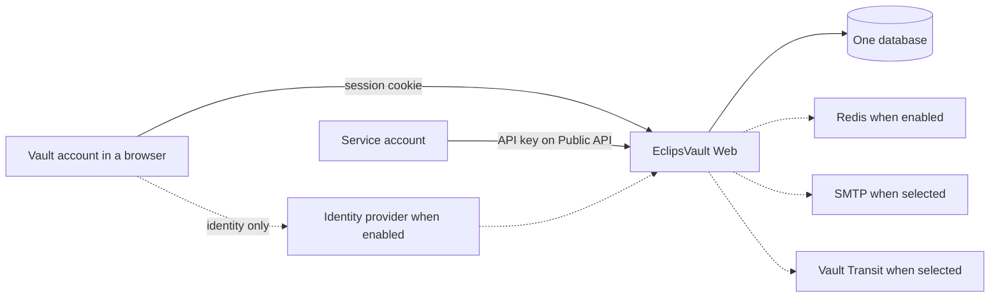
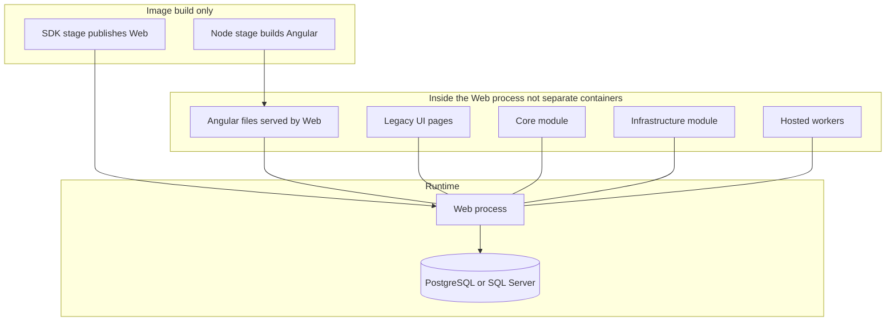
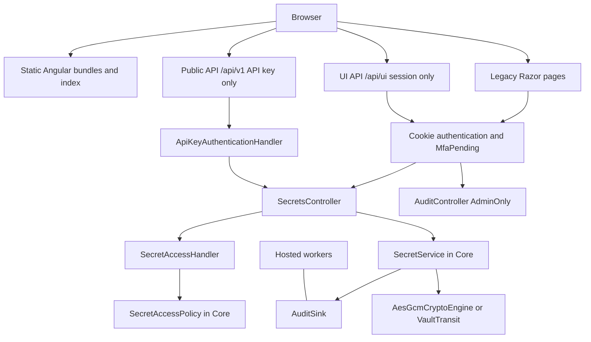
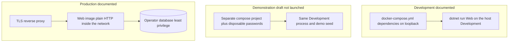

# Diagrams / დიაგრამები

These are C4-style views of the revision named in each table. Boxes are English source names so a
diagram stays searchable. The caption under each figure is bilingual.

**Current** is `origin/main` at `0bb59de1e8f64d1b7d04468c303c1b108dd6f04b`. **Same on Area 6a** means
the named file has no diff against `ab7997e14ba98fd37055e6ca77fab4c6c8aba490`. **Planned** is not
drawn as a box that exists.

Core and Infrastructure are never containers. Node is never a runtime container.

## 1. Context

Who talks to the vault, and which neighbours exist only when configured.



Caption / წარწერა: one self-hosted vault decides access and holds the sealed secrets. The dashed
boxes are configuration, not part of every deployment. / ერთი თვითჰოსტირებული საცავი წყვეტს წვდომას
და ინახავს დაბეჭდილ საიდუმლოებს. წყვეტილი უჯრები კონფიგურაციაა, არა ყოველი განთავსების ნაწილი.

| Element | Source at `0bb59de` | State |
|---|---|---|
| Vault account, session, second factor | `CONTEXT.md` | current vocabulary |
| Service account, API key, Public API, UI API | `CONTEXT.md`; ADR-0005 | current |
| Browser holds no access token; session cookie | ADR-0002; `Program.cs` cookie `EclipsVault.Session` | current, same on Area 6a |
| Person to vault | `AccountController.Login` then `SessionIssuer.SignInAsync` | current |
| Service account to Public API | `SecretsApiController` route `api/v1/secrets`; `ApiKeyAuthenticationHandler` | current |
| One database | `DependencyInjection` reads `Database:Provider` once; `DatabaseProvider` | current, same on Area 6a |
| Redis dashed | `appsettings.json` `Redis:Enabled` false; `DependencyInjection` branches on it | current |
| SMTP dashed | `DependencyInjection` uses `SmtpEmailSender` only when `Email:Sender` is `Smtp`; committed default in `appsettings.json` is `Log` | current |
| Vault Transit dashed | `appsettings.json` `Crypto:Engine` `AesGcmLocal`; `VaultTransitCryptoEngine` constructed for `VaultTransit` | current |
| Identity provider dashed | `Program.cs` wires OpenID Connect only when `SsoOptions.Enabled`; ADR-0002 says the IdP proves identity and the vault decides admission | current |
| Angular not a separate system | ADR-0008 | current |

## 2. Container

Runtime containers versus build stages and in-process modules. The production image has one
application container.



Caption / წარწერა: Node and the SDK exist while the image is built. At runtime there is Web and the
one selected database. / Node და SDK იმიჯის აწყობისას არსებობს. გაშვებისას არის Web და ერთი არჩეული
ბაზა.

| Element | Source at `0bb59de` | State |
|---|---|---|
| Node stage `ui` | `Dockerfile` `FROM node:24.22.0-bookworm-slim … AS ui`, `npm run build` | current, same on Area 6a |
| SDK stage and runtime stage | `Dockerfile` `AS build`, `AS runtime`, `ENTRYPOINT` `EclipsVault.Web.dll` | current, same on Area 6a |
| Angular copied into the runtime image | `Dockerfile` copies `wwwroot/ui` and `AngularUi` from the `ui` stage | current, same on Area 6a |
| Web serves Angular from its own origin | ADR-0008; `AngularUiRoutes.MapAngularUi` | current |
| Legacy pages remain for paths not listed | `AngularUiRoutes` path list has no `/Secrets` details and no `/Audit` | current on `main`. Area 6a adds Encryption keys routes; not merged |
| Core module, no packages | `EclipsVault.Core.csproj`; `EclipsVault.Web.csproj` project reference | current |
| Infrastructure module | `EclipsVault.Infrastructure.csproj` references Core; Web references Infrastructure | current |
| PostgreSQL migrations assembly loaded by Web | `EclipsVault.Web.csproj` references `EclipsVault.Migrations.Postgres` | current |
| Postgres migrations reference Infrastructure | `EclipsVault.Migrations.Postgres.csproj` | current |
| One provider | `DatabaseProvider.UseVaultDatabase` | current |
| Hosted workers inside Web | `Program.cs` `AddHostedService` for `SecretLifecycleWorker`, `DynamicLeaseWorker`, `LicenseStartupCheck`; `DependencyInjection` hosts `AuditGroupCommitter` | current, same registration site on Area 6a for these four |
| Offline verifier is not this container | `EclipsVault.AuditVerifier.csproj` references Core only | current; a separate tool, not a vault container |
| Development dependencies are not this picture's runtime | `docker-compose.yml` header: local development only, dependencies, not a deployment | current, same on Area 6a |

`docker-compose.yml` does not run Web. ADR-0008 says the compose file is unaffected and runs only
the dependencies. The process beside it is `dotnet run --project EclipsVault.Web`, from the README.

## 3. Web component

The pieces inside the Web process that the talk touches. Controllers stay thin; the access rule
lives in Core.



Caption / წარწერა: the same access policy serves a session and an API key. The audit page is a
Legacy administrator page on this revision. / ერთი და იგივე წვდომის წესი ემსახურება სესიასაც და
API გასაღებსაც. ამ რევიზიაზე აუდიტის გვერდი Legacy ადმინისტრატორის გვერდია.

| Element | Source at `0bb59de` | State |
|---|---|---|
| Angular document outside `wwwroot`, bundles under `wwwroot/ui` | `AngularUiRoutes` | current |
| Route table, session or `AdminOnly` | `AngularUiRoutes.Paths` and `administratorPaths` | current. `/Audit` is not in the list |
| UI API session, Public API key, neither accepts the other | ADR-0005 | current |
| UI API problem responses | ADR-0006; `Program.cs` `MapFallback("/api/ui/{**path}")` | current |
| Cookie names and flags | `Program.cs` `EclipsVault.Session`, `EclipsVault.MfaPending`, `HttpOnly`, `Secure`, `SameSite=Strict` | current, same on Area 6a |
| API key handler | `ApiKeyAuthenticationHandler` | current |
| Secrets HTTP | `SecretsController` | current |
| Access handler delegates to Core | `SecretAccessHandler`; `SecretAccessPolicy` | current |
| Reveal service | `SecretService` | current, same on Area 6a |
| Standalone audit commit | `AuditSink`; `AuditGroupCommitter` | current |
| Local or Transit engine | `CryptoEngineFactory`; `AesGcmCryptoEngine`; `VaultTransitCryptoEngine` | current |
| Audit page | `AuditController` with `VaultPolicies.AdminOnly` | current. Area 6b plans an Angular page; not built |
| Workers | `Program.cs` and `DependencyInjection` as in the container table | current |
| Server decides what the UI may show | ADR-0012 | current |
| Browser to Angular files | `Program.cs` `UseStaticFiles`; `AngularUiRoutes.ServeIndex` | current |
| Browser to Legacy pages | `Program.cs` default controller route; paths absent from `AngularUiRoutes` | current |
| Browser to UI API and Public API | ADR-0005 | current |
| Legacy and UI API through the session cookie | `Program.cs` cookie scheme; ADR-0002 | current |
| Public API through the API key handler | `SecretsApiController` `[Authorize(AuthenticationSchemes = AuthSchemes.ApiKey)]` | current |
| Secrets controller to handler, handler to policy | `SecretsController.CheckAccessAsync`; `SecretAccessHandler` | current |
| Secrets controller to `SecretService`, then sink and engine | `SecretService.RevealAsync` | current, same on Area 6a |
| Session to audit page | `AuditController` `AdminOnly` | current |
| Hosted committer to the sink | `DependencyInjection` hosts `AuditGroupCommitter`; `AuditSink` waits on it | current |

## 4. Focused code: reveal

Success path for an Internal secret that does not need step-up. This is the talk's secret.

```mermaid
sequenceDiagram
  participant Browser
  participant Controller as SecretsController.Reveal
  participant Details as SecretService.GetDetailsAsync
  participant Access as SecretAccessHandler
  participant Policy as SecretAccessPolicy
  participant Reveal as SecretService.RevealAsync
  participant Sink as AuditSink
  participant Crypto as ICryptoEngine.UnsealAsync

  Browser->>Controller: POST reveal
  Controller->>Details: load envelope
  Details->>Sink: commit Viewed
  Controller->>Access: CheckAccessAsync
  Access->>Policy: Evaluate
  Policy-->>Access: allow
  Access-->>Controller: allow
  Controller->>Reveal: RevealAsync
  Reveal->>Sink: commit SecretRevealed
  Sink-->>Reveal: committed
  Reveal->>Crypto: unwrap data key and open value
  Crypto-->>Browser: plaintext in the page
```

Caption / წარწერა: `SecretRevealed` is committed before `UnsealAsync`. The earlier `Viewed` row is
the details load, and it is written before the access decision. / `SecretRevealed` ფიქსირდება
`UnsealAsync`-მდე. უფრო ადრეული `Viewed` დეტალების ჩატვირთვაა და წვდომის გადაწყვეტამდე იწერება.

| Element | Source at `0bb59de` | State |
|---|---|---|
| Session required to reach the controller | `VaultController` `[Authorize(Policy = VaultPolicies.Session)]` | current |
| `Reveal` calls `GetDetailsAsync` then `CheckAccessAsync` | `SecretsController.Reveal` | current, same on Area 6a |
| `GetDetailsAsync` audits `SecretMetadataViewed` | `SecretService.GetDetailsAsync` | current, same on Area 6a |
| Label `Viewed` | `AuditDisplay` | current |
| Access decision | `SecretsController.CheckAccessAsync`; `SecretAccessHandler`; `SecretAccessPolicy.Evaluate` | current |
| Denial redirects and does not call `RevealAsync` | `CheckAccessAsync` returns a redirect | current |
| Step-up skipped below Secret | `appsettings.json` `StepUp:MinimumSensitivity` `Secret`; `SecretsController.Reveal` | current |
| Audit then decrypt | `SecretService.RevealAsync` comment and call order; `DecryptToDtoAsync` | current, same on Area 6a |
| Sink waits for commit | `AuditSink` | current |
| Failure type | `AuditWriteFailedException` from `AuditSink` | current. Area 6a touches the exception file; the reveal call order does not change |
| Local unwrap | `AesGcmCryptoEngine.UnsealAsync` unwraps the data key with the master key, then opens the payload | current |
| Screen label `Revealed` | `AuditDisplay` for `AuditAction.SecretRevealed` | current |
| Plaintext reaches the browser after success | `SecretsController.Reveal` returns the details view with `revealed.Value` | current. Do not record that screen |

Honey-token trips are not in this sequence. `GetDetailsAsync` and `RevealAsync` call
`TripHoneyTokenIfNeededAsync` before their audit write. The talk never uses that path. The decoy
names are in the demo draft so they can be avoided.

## 5. Deployment

Three ways to run the same Web process. Only Development and production are repository deployment
descriptions. The demonstration is a proposed disposable use of Development. It was not launched.



Caption / წარწერა: the middle column reuses Development. It is not a third product mode, and this
draft did not start it. / შუა სვეტი Development-ს იყენებს. ის მესამე პროდუქტის რეჟიმი არ არის და ამ
მონახაზმა ის არ გაუშვა.

| Element | Source at `0bb59de` | State |
|---|---|---|
| Compose is a laptop, public dev passwords, no TLS, loopback ports | `docker-compose.yml` header | current, same on Area 6a |
| Compose services: PostgreSQL, Vault dev, Mailpit, Redis, Keycloak | `docker-compose.yml` service names `db`, `vault`, `mailpit`, `redis`, `keycloak` | current. Present does not mean the process uses them |
| Web is not a compose service | `docker-compose.yml`; ADR-0008 | current |
| Development seeds the demo world | `DbSeeder.SeedDevelopmentDataAsync`, called only when the host is Development | current |
| Development applies migrations | `DatabaseMigrator` `environment.IsDevelopment()` | current |
| Production bootstraps one administrator and no sample secrets | `DbSeeder` production path; `DbSeederTests` names that behaviour | current |
| Production does not migrate unless `Database:MigrateOnStartup` | `DatabaseMigrator`; `docs/INSTALL.md` | current |
| Production image listens on 8080 without TLS | `Dockerfile` `ASPNETCORE_HTTP_PORTS=8080`; `docs/INSTALL.md` | current |
| Production provider, connection, KEK, audit signing key, key ring | `docs/INSTALL.md` section 2 | current. Values are the operator's, not in this draft |
| Demonstration column | [demo-setup-reset.md](demo-setup-reset.md) | draft procedure, not executed |
| Browser end-to-end stack | `AGENTS.md` browser section: production image, SQL Server, Redis, SMTP capture, TLS proxy | a test harness, not the talk and not production |

The end-to-end harness is omitted from the picture so it is not mistaken for the demonstration.
It is a fourth shape, used by Playwright, and it was not started.
