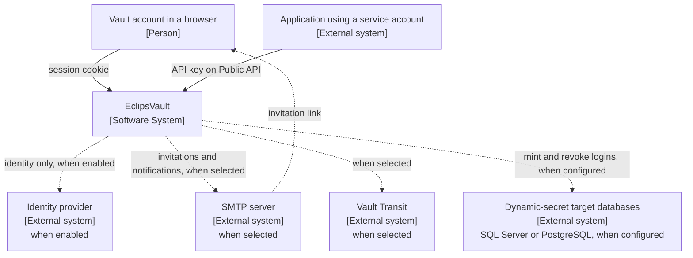
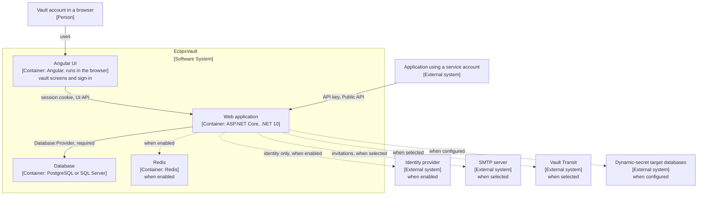
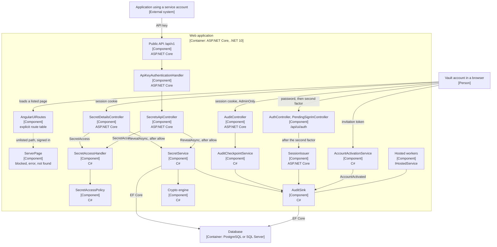
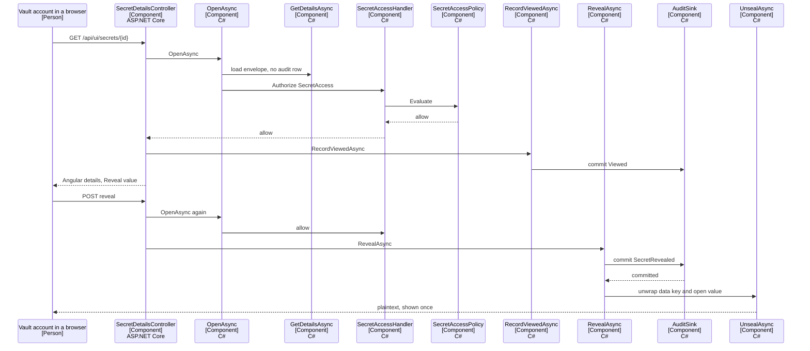

# Diagrams / დიაგრამები

C4 views of `origin/main` at `1298958050e45f83aefeb4b6455d0a02169ab22a`
(24 November 2026, 15:18 Asia/Tbilisi). Every box has a bracketed C4 type. Containers use
`[Container: technology]` and components use `[Component]`, each with a short technology line.
People, the software system, and external systems carry only the type.

The Angular UI, including sign-in, is a container that runs in the browser. Section 2 also shows
the database and Redis as runtime containers. The Web application contains Core
and Infrastructure (section 3) and writes three server pages for access blocked, error, and not
found. This revision has no Razor views. Node and the .NET SDK build the image (section 5).

The rendered pages are [diagrams.html](diagrams.html) and the files in [svg/](svg/). Regenerate
them with `npm run render` in [render/](render/).

## 1. Context

EclipsVault is the software system at the centre of the context diagram. The diagram shows who
connects to it. The database and Redis are internal and appear in the container view.

Caption / წარწერა: EclipsVault is one software system. A person uses a vault account and a session
in the browser. An application with a service account is an external system and calls the Public
API with an API key. The vault sends invitation links through SMTP, and recipients use them to
activate their accounts. The identity provider, SMTP, Vault Transit, and the dynamic-secret target
databases are available only when their respective integrations are configured. / EclipsVault ერთი
პროგრამული სისტემაა. ბრაუზერში მომხმარებელი საცავის ანგარიშითა და სესიით სარგებლობს. სერვისის ანგარიშის
მქონე აპლიკაცია გარე სისტემაა და საჯარო API-ს API გასაღებით მიმართავს. საცავი მოწვევის ბმულს SMTP-ით
აგზავნის, ადრესატი კი ამ ბმულით ანგარიშს ააქტიურებს. იდენტობის პროვაიდერი, SMTP, Vault Transit და
დინამიკური საიდუმლოების სამიზნე ბაზები შესაბამისი ინტეგრაციის გამართვის შემდეგ გამოიყენება.

| Element | Source at `1298958` |
|---|---|
| Vault account in a browser `[Person]` | `CONTEXT.md` vault account, session, second factor |
| Application using a service account `[External system]` | `CONTEXT.md`: a service account is a non-interactive identity for an application. It never has a session |
| EclipsVault `[Software System]` | ADR-0008: one origin, one process serves the UI and both APIs |
| Session-cookie edge | ADR-0002; `Program.cs` cookie `EclipsVault.Session` |
| Person to the system | Angular `/Account/Login` page, `AuthController.Password`, then `SessionIssuer.SignInAsync` after the second factor (ADR-0032) |
| That application to the Public API | `SecretsApiController` route `api/v1/secrets`; `ApiKeyAuthenticationHandler` |
| Identity provider `[External system]`, when enabled | `Program.cs` wires OpenID Connect only when `SsoOptions.Enabled`; `AccountController` keeps only `/Account/ExternalLogin` and `/Account/ExternalCallback`; ADR-0002: the IdP proves identity and the vault decides admission |
| SMTP server `[External system]`, when selected | `DependencyInjection` uses `SmtpEmailSender` only when `Email:Sender` is `Smtp`; committed default in `appsettings.json` is `Log`. `AccountInvitationDelivery` sends only when real SMTP and `Identity:PublicUrl` are set (ADR-0033) |
| Invitation link to the person | ADR-0033: single-use, 72 hours, token in the link's fragment; `InvitationToken` |
| Vault Transit `[External system]`, when selected | `appsettings.json` `Crypto:Engine` is `AesGcmLocal`; `VaultTransitCryptoEngine` is used when the engine is `VaultTransit` |
| Dynamic-secret target databases `[External system]`, when configured | `SqlServerBackend` with `DynamicSecrets:TargetConnectionString`; `PostgresBackend` with `DynamicSecrets:PostgresTargetConnectionString`. `docs/INSTALL.md`: never the vault's own database, and on PostgreSQL a distinct cluster |
| Angular UI container | ADR-0008: Web serves it from the same origin. The container is part of EclipsVault and appears in section 2 |
| Database and Redis | Drawn in section 2. `DependencyInjection` requires one `Database:Provider`. `appsettings.json` sets `Redis:Enabled` false |

## 2. Container

The system boundary contains the runtime containers. The people and external systems from section 1
stay outside it. Section 3 shows the Web application's components: Core, Infrastructure, the route
table, the server pages, and the hosted workers. Section 5 names the image-build stages and omits
them from the diagram.

Caption / წარწერა: The Angular UI, Web application, and one database are separate runtime containers.
Redis is a fourth container when enabled. In the browser, the Angular UI handles sign-in and calls
the UI API with the session cookie. The Web application serves the Angular files, handles the UI
API and the Public API, and returns three server pages. It requires `Database:Provider` at startup.
The person and external systems are outside the system boundary. / გაშვებისას Angular UI, Web
აპლიკაცია და ერთი მონაცემთა ბაზა ცალკე კონტეინერებია. თუ Redis ჩართულია, ის მეოთხე კონტეინერია.
Angular UI ბრაუზერში ამუშავებს შესვლას და UI API-ს სესიის ქუქით მიმართავს. Web აპლიკაცია Angular-ის
ფაილებს აწვდის ბრაუზერს, ამუშავებს UI API-ისა და საჯარო API-ის მოთხოვნებს და აბრუნებს სამ სერვერულ
გვერდს. გასაშვებად მას `Database:Provider` სჭირდება. მომხმარებელი და გარე სისტემები სისტემის საზღვრის
მიღმაა.

| Element | Source at `1298958` |
|---|---|
| Vault account in a browser `[Person]` | `CONTEXT.md` vault account; outside the system boundary |
| Application using a service account `[External system]` | `CONTEXT.md` service account; outside the system boundary |
| Identity provider, SMTP server, Vault Transit, target databases | Same configuration gates as section 1. Each arrow leaves the Web application and ends at that external system |
| EclipsVault `[Software System]` boundary | ADR-0008: one system, one origin |
| Angular UI `[Container: Angular, runs in the browser]` | ADR-0008 and `Dockerfile` `ui` stage: the built files run in the browser. `AngularUiRoutes` serves the document for the listed Angular routes, including sign-in (ADR-0032, ADR-0034) |
| Arrow from Angular UI to Web, session cookie and UI API | ADR-0002; ADR-0005; `Program.cs` cookie `EclipsVault.Session` |
| Web application `[Container: ASP.NET Core, .NET 10]` | `Dockerfile` runtime stage, `ENTRYPOINT` `EclipsVault.Web.dll`. It serves the Angular files, `/api/ui/`, `/api/v1/`, and `ServerPage` for access blocked, error, and not found. `EclipsVault.Web` has no `Views` folder, no `site.css`, and no `site.js` |
| Database `[Container: PostgreSQL or SQL Server]` | `DependencyInjection` throws "Database:Provider is not set" when it is missing; `DatabaseProvider` refuses an unknown value |
| Redis `[Container: Redis]`, when enabled | `appsettings.json` `Redis:Enabled` false; `DependencyInjection` registers Redis implementations only when it is true |
| Core, Infrastructure, route table, server pages, hosted workers | Section 3 shows them as components of the Web application |
| Node and .NET SDK build stages | Section 5 lists the `Dockerfile` stages `ui` and `build` for image assembly only |

## 3. Web component

A person with a vault account loads the Angular document from a route in the table. The UI calls
the UI API to sign in, then uses the session for secret and audit requests. Only applications with
a service account call the Public API. The database is outside the Web container. SecretService
and AuditSink reach it through EF Core. The controllers delegate access decisions to Core.

Caption / წარწერა: `AngularUiRoutes` serves the Angular document only on listed paths, including
sign-in. If a signed-in user requests an unlisted path, `ServerPage` returns the not-found page.
`AuthController` and `PendingSignInController` handle sign-in. `SessionIssuer` issues a session
after the second factor. The vault activates an account with its invitation token in one audited
transaction. `SecretDetailsController` checks access through `SecretAccessHandler`. It records
`Viewed` after access is allowed and calls `RevealAsync` only if the later check allows it too.
Public API requests reach `SecretsApiController` through the API key handler and use the same
access policy. `AuditController` is `AdminOnly`. / `AngularUiRoutes` Angular-ის დოკუმენტს მხოლოდ
ჩამოთვლილ მარშრუტებზე აბრუნებს, მათ შორის შესვლის გვერდებზე. თუ უკვე შესული მომხმარებელი სიაში
არმყოფ მისამართს მიმართავს, `ServerPage` აბრუნებს გვერდს „ვერ მოიძებნა“. შესვლის მოთხოვნებს
`AuthController` და `PendingSignInController` ამუშავებს. `SessionIssuer` სესიას მეორე ფაქტორის
დადასტურების შემდეგ გასცემს. საცავი მოწვევის ტოკენით ანგარიშს ერთ ტრანზაქციაში ააქტიურებს და
აქტივაციას აუდიტში აღრიცხავს. `SecretDetailsController` წვდომას `SecretAccessHandler`-ით ამოწმებს.
ნებართვის შემდეგ წერს `Viewed`-ს და განმეორებითი შემოწმების წარმატებით გავლის შემდეგ იძახებს
`RevealAsync`-ს. საჯარო API-ის მოთხოვნა `SecretsApiController`-მდე API გასაღების დამმუშავებლის
გავლით მიდის და წვდომის იმავე პოლიტიკას ექვემდებარება. `AuditController`-ზე მოქმედებს `AdminOnly`.

| Element | Source at `1298958` |
|---|---|
| Vault account in a browser `[Person]` | `CONTEXT.md` vault account; ADR-0002: the browser holds the session cookie and no access token |
| `AngularUiRoutes` `[Component]` | `EclipsVault.Web/Hosting/AngularUiRoutes.cs`. `Paths` includes `/Secrets`, `/Secrets/Details/{id:guid}`, `/DynamicSecrets`, `/Account/Denied`. `administratorPaths` includes `/Audit`, `/Encryption`, `/Admin/Networks`. `/Account/Login`, `/Account/Recover`, and `/Account/Activate` are anonymous; `/Account/Totp`, `/Account/RecoveryCode`, `/Account/EnrollTotp` need the pending sign-in cookie. ADR-0034: no catch-all |
| Angular bundles | `AngularUiRoutes.IndexPath`: document outside `wwwroot`, bundles under `wwwroot/ui`. Not drawn as a separate box |
| `ServerPage` `[Component]` | `EclipsVault.Web/Middleware/ServerPage.cs` and `wwwroot/css/server-page.css`: `ErrorAsync`, `BlockedAsync`, `NotFoundAsync`. No script. ADR-0034 |
| `AuthController`, `PendingSignInController` `[Component]` | Route `api/ui/auth`. `AuthController`: `options`, `password`, `passkey/begin`, `passkey/complete`, `recover`, `activation`, `activation/complete`, `sign-out`. `PendingSignInController`, pending sign-in only: `totp`, `recovery-code`, `enrollment`, `enrollment/confirm`. ADR-0032 |
| `SessionIssuer` `[Component]` | `SessionIssuer.SignInAsync`, called after TOTP, recovery code, enrollment, passkey, or SSO |
| `AccountActivationService` `[Component]` | `AuthController.InspectActivation` and `CompleteActivation`. ADR-0033: password, authenticator, spent token, and `AccountActivated` in one transaction |
| UI API problem responses | ADR-0006; ADR-0034: errors answer in the caller's format |
| `ApiKeyAuthenticationHandler` `[Component]` | `ApiKeyAuthenticationHandler` |
| `SecretDetailsController` `[Component]` | `SecretDetailsController` on `api/ui/secrets/{id}`. `OpenAsync` loads details, then `VaultPolicies.SecretAccess`. `Get` calls `RecordViewedAsync` only after allow. `Reveal` calls `RevealAsync` only after allow and, when required, step-up |
| `SecretsApiController` to handler, then `RevealAsync` | `SecretsApiController.Get` on `api/v1/secrets/{id}` asks `SecretAccess`, records `SecretAccessDenied` on refusal, and calls `RevealAsync` after allow |
| `SecretAccessHandler` and `SecretAccessPolicy` `[Component]` | `SecretAccessHandler` delegates to `SecretAccessPolicy.Evaluate`, which answers allow or deny and does not call `SecretService` |
| `SecretService` `[Component]` | `SecretService`. `GetDetailsAsync` loads ordinary secret metadata without writing an audit row. `RevealAsync` commits `SecretRevealed` before `DecryptToDtoAsync` |
| `AuditSink` `[Component]` | `AuditSink`; `AuditGroupCommitter` |
| `AuditCheckpointService` `[Component]` | `AuditCheckpointService.VerifyAsync` and `ExportAsync`; `AuditChainVerifier.VerifyAsync` |
| `AuditController` `[Component]` | `AuditController` on `api/ui/audit`, `VaultPolicies.AdminOnly`. `Get` writes `AuditLogViewed` before listing |
| Crypto engine `[Component]` | `CryptoEngineFactory`; `AesGcmCryptoEngine`; `VaultTransitCryptoEngine`. `ICryptoEngine.GetMasterKeysAsync`. `IKekRotationService` is `KekRotationService`, reached from `EncryptionController` |
| Hosted workers `[Component]` | `Program.cs` registers `SecretLifecycleWorker`, `DynamicLeaseWorker`, and `LicenseStartupCheck`. `DependencyInjection` hosts `AuditGroupCommitter`. These threads run inside the Web container |
| Server decides what the UI may show | ADR-0012 |
| Database `[Container: PostgreSQL or SQL Server]`, outside Web | `DependencyInjection` `AddDbContext`; `DatabaseProvider.UseVaultDatabase` |
| SecretService and AuditSink to the database, EF Core | `SecretService` writes through its repository; `AuditSink` commits through `AuditGroupCommitter`. Both use the EF Core `EclipsVaultDbContext`. `AuditSaveChangesInterceptor` stamps every audit insert into the hash chain |

## 4. Focused code: reveal

The demo's Internal secret follows this sequence without step-up. The vault account is the person
in the sequence, and the other participants are components. Mermaid treats `#` as a comment on
this sequence line, so the label uses `C#35;` to render `C#`.

Caption / წარწერა: The server checks access to the details page before committing `Viewed`. For a
reveal, it checks access again and commits `SecretRevealed` before calling `UnsealAsync`. The
Angular page displays the plaintext once. / სერვერი დეტალების გვერდზე წვდომას `Viewed`-ის
დაფიქსირებამდე ამოწმებს. გამჟღავნებამდე წვდომას ხელახლა ამოწმებს და `UnsealAsync`-ის გამოძახებამდე
`SecretRevealed`-ს აფიქსირებს. Angular-ის გვერდი გაშიფრულ მნიშვნელობას ერთხელ აჩვენებს.

| Element | Source at `1298958` |
|---|---|
| Vault account in a browser `[Person]` | `CONTEXT.md` vault account. The page is `secret-details-page`, route `/Secrets/Details/{id}` |
| `SecretDetailsController` `[Component]` | `SecretDetailsController.Get` and `Reveal` |
| `OpenAsync` `[Component]` | `SecretDetailsController.OpenAsync` calls `GetDetailsAsync`, then `IAuthorizationService.AuthorizeAsync` with `VaultPolicies.SecretAccess` |
| `GetDetailsAsync` `[Component]` | `SecretService.GetDetailsAsync` loads the envelope without writing an audit row for an ordinary secret. A decoy trips the intrusion response. ADR-0031 |
| `RecordViewedAsync` `[Component]` | `SecretService.RecordViewedAsync` writes `SecretMetadataViewed`, and only from `Get` after allow |
| Label `Viewed` | `AuditDisplay` for `AuditAction.SecretMetadataViewed` |
| Denial writes `SecretAccessDenied` and does not reveal | `OpenAsync` calls `RecordAccessDeniedAsync` and returns 403 `access_denied`. `Reveal` is not called |
| Step-up skipped below Secret | `appsettings.json` `StepUp:MinimumSensitivity` `Secret`; `SecretDetailsController.StepUpRequiredAsync` |
| `RevealAsync` then `AuditSink` `[Component]` | `SecretService.RevealAsync` awaits `AuditSecretAsync` for `SecretRevealed` before `DecryptToDtoAsync` |
| Audit commit failure | `AuditSink` throws `AuditWriteFailedException` and returns no success |
| `UnsealAsync` `[Component]` | `AesGcmCryptoEngine.UnsealAsync` unwraps the data key with the master key, then opens the payload. `DecryptToDtoAsync` zeroes the buffer |
| Screen label `Revealed` | `AuditDisplay` for `AuditAction.SecretRevealed` |
| Plaintext on the Angular page, once | `secret-details-page.html`: "This reveal was recorded in the audit trail before decryption. The value is shown once…". Do not record that screen |

The demo skips honey-tokens. On that path, `GetDetailsAsync` and `RevealAsync` call
`TripHoneyTokenIfNeededAsync` before any audit write. Check the decoy names in the demo setup
before selecting the secret.

## 5. Deployment

Development and production are deployment nodes for the containers in section 2. Each node
contains the containers that run there. The Angular UI runs in a browser in either environment.
In Development, Web runs on the developer machine and the database runs in a Docker Compose
project. The reference in `deploy/production/` puts Caddy, the vault image, and PostgreSQL on one
Docker host. Caddy provides automatic HTTPS, and a named volume holds the Data Protection key
ring. The demo uses a disposable Development vault. The Dockerfile's Node and .NET SDK stages
build the image and sit outside the runtime diagram.

```mermaid
%%{init: {"flowchart": {"wrappingWidth": 560}} }%%
flowchart TB
  subgraph development ["Development<br/>[Deployment node]"]
    subgraph browserDev ["Developer browser<br/>[Deployment node]"]
      angularDev["Angular UI<br/>[Container: Angular, runs in the browser]"]
    end
    subgraph machine ["Developer machine<br/>[Deployment node]"]
      webDev["Web application<br/>[Container: ASP.NET Core, .NET 10]"]
      subgraph dockerDev ["Docker host<br/>[Deployment node: Docker Engine]"]
        subgraph compose ["Compose project<br/>[Deployment node: Docker Compose]"]
          dbDev["Database<br/>[Container: PostgreSQL]"]
          redisDev["Redis<br/>[Container: Redis]<br/>when enabled"]
        end
      end
    end
  end
  subgraph production ["Production, reference deployment<br/>[Deployment node]"]
    subgraph browserProd ["Browser<br/>[Deployment node]"]
      angularProd["Angular UI<br/>[Container: Angular, runs in the browser]"]
    end
    subgraph host ["Linux host<br/>[Deployment node: Docker Compose, deploy/production]"]
      caddy["Caddy<br/>[Deployment node: automatic HTTPS]<br/>network front"]
      webProd["Web application<br/>[Container: ASP.NET Core, .NET 10]<br/>signed image digest"]
      keyring["Data Protection key ring<br/>[Deployment node: named volume]"]
      dbProd["Database<br/>[Container: PostgreSQL]<br/>network back, internal"]
    end
  end
  angularDev -->|session cookie, UI API| webDev
  webDev -->|Database:Provider Postgres| dbDev
  webDev -.->|when enabled| redisDev
  angularProd -->|HTTPS, session cookie, UI API| caddy
  caddy -->|plain HTTP on 8080, KnownProxies| webProd
  webProd -->|Database:Provider Postgres| dbProd
  webProd --- keyring
```

Caption / წარწერა: Development and production are the two deployment nodes. In Development, Web
runs on the developer machine and PostgreSQL runs in Compose. The production reference runs Caddy,
the vault image, and PostgreSQL on one Docker host. Caddy obtains the certificate. The vault trusts
forwarded addresses only from Caddy's fixed address, and the database runs on an internal network.
The demo is one disposable run in Development. / Development და Production განთავსების ორი
კვანძია. Development გარემოში Web დეველოპერის კომპიუტერზე ეშვება, PostgreSQL კი Compose პროექტში.
Production-ის ნიმუშში Caddy, საცავის იმიჯი და PostgreSQL ერთ Docker ჰოსტზე ეშვება. სერტიფიკატს Caddy
იღებს. საცავი გადმოცემულ მისამართებს მხოლოდ Caddy-ის ფიქსირებული მისამართიდან ენდობა. მონაცემთა ბაზა
შიდა ქსელშია. დემონსტრაცია Development გარემოში ერთხელ ჩატარდა, ერთჯერად საცავში.

| Element | Source at `1298958` |
|---|---|
| Developer browser `[Deployment node]` and Angular UI container | ADR-0008: the Angular UI runs in the browser. Same container as section 2 |
| Developer machine `[Deployment node]` and Web application container | `README.md` `dotnet run --project EclipsVault.Web`. Web is not a compose service; ADR-0008 |
| Docker host `[Deployment node: Docker Engine]` | The `docker-compose.yml` header describes a laptop with loopback ports. Web runs directly on the laptop |
| Compose project `[Deployment node: Docker Compose]` | `docker-compose.yml` services `db` and `redis`. Also starts `vault`, `mailpit`, and `keycloak`, which this picture does not draw. Present does not mean the process uses them |
| Development database `[Container: PostgreSQL]` | Compose service `db` is PostgreSQL only. `appsettings.Development.json.template` sets `Database:Provider` to `Postgres` |
| Development Redis container, when enabled | Compose service `redis`; `appsettings.json` `Redis:Enabled` false |
| Linux host, Docker Compose | `deploy/production/compose.yaml` (project `eclipsvault`, services `caddy`, `vault`, `db`); `docs/INSTALL.md` "Quickest path" |
| Caddy, automatic HTTPS | `deploy/production/Caddyfile`: `reverse_proxy vault:8080` for `{$EV_DOMAIN}`; ports 80 and 443; fixed address `172.31.255.2` on network `front` |
| Web application, signed image digest | `compose.yaml` `vault`: `EV_IMAGE` is the verified digest; `ASPNETCORE_ENVIRONMENT` Production; `ForwardedHeaders__KnownProxies__0` `172.31.255.2`; `Identity__PublicUrl` `https://${EV_DOMAIN}`; `Database__Provider` `Postgres`; `Database__MigrateOnStartup` true |
| Data Protection key ring, named volume | `compose.yaml` `DataProtection__KeyRingPath: /keyring`, volume `keyring` |
| Production database `[Container: PostgreSQL]` | In `compose.yaml`, `db` uses `postgres:17` pinned by digest and the `back` network with `internal: true`. The vault signs in under the non-superuser account `eclipsvault_app` |
| Secrets for this deployment | The operator supplies the values in `.env` beside `compose.yaml`, starting from `.env.example` |
| `down -v` deletes every secret | `compose.yaml` header: `down` keeps the volumes; `down -v` deletes them |
| SQL Server in production | Still supported by `Database:Provider` `SqlServer` and `docs/INSTALL.md`; the reference compose file uses PostgreSQL |
| Development demonstration | [demo-setup-reset.md](demo-setup-reset.md): one disposable Development run on this revision |
| Node image-build stage, omitted | `Dockerfile` `AS ui`, `npm run build` |
| .NET SDK image-build stage, omitted | `Dockerfile` `AS build`, `dotnet publish` |
| Production bootstraps one administrator and no sample secrets | `DbSeeder` production path; `DbSeederTests` names that behaviour |
| Browser end-to-end stack, omitted | `AGENTS.md` browser section: Playwright test stack with a production image, SQL Server, Redis, SMTP capture, and a TLS proxy. It runs separately from Development, production, and the talk |
