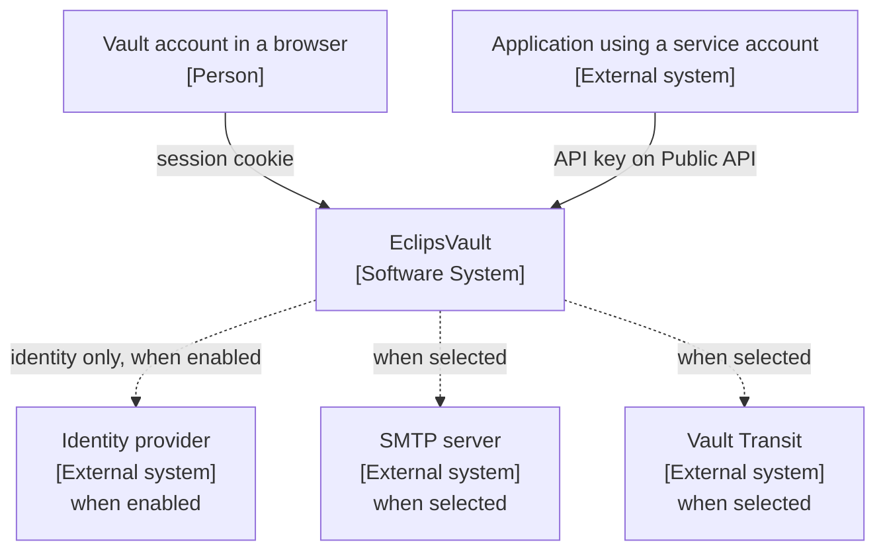
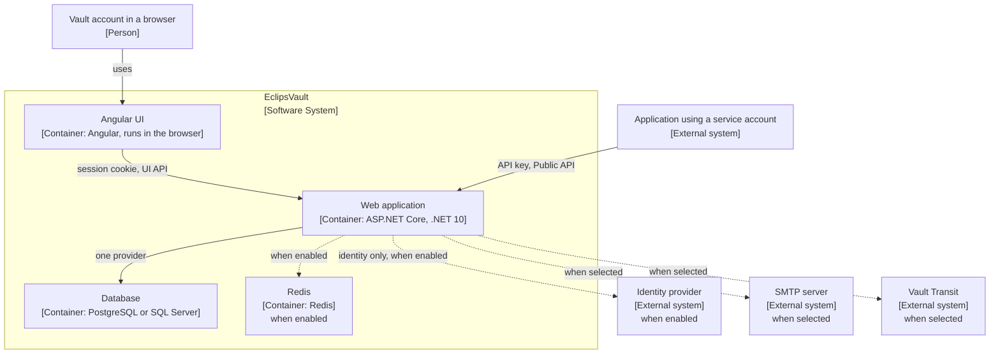
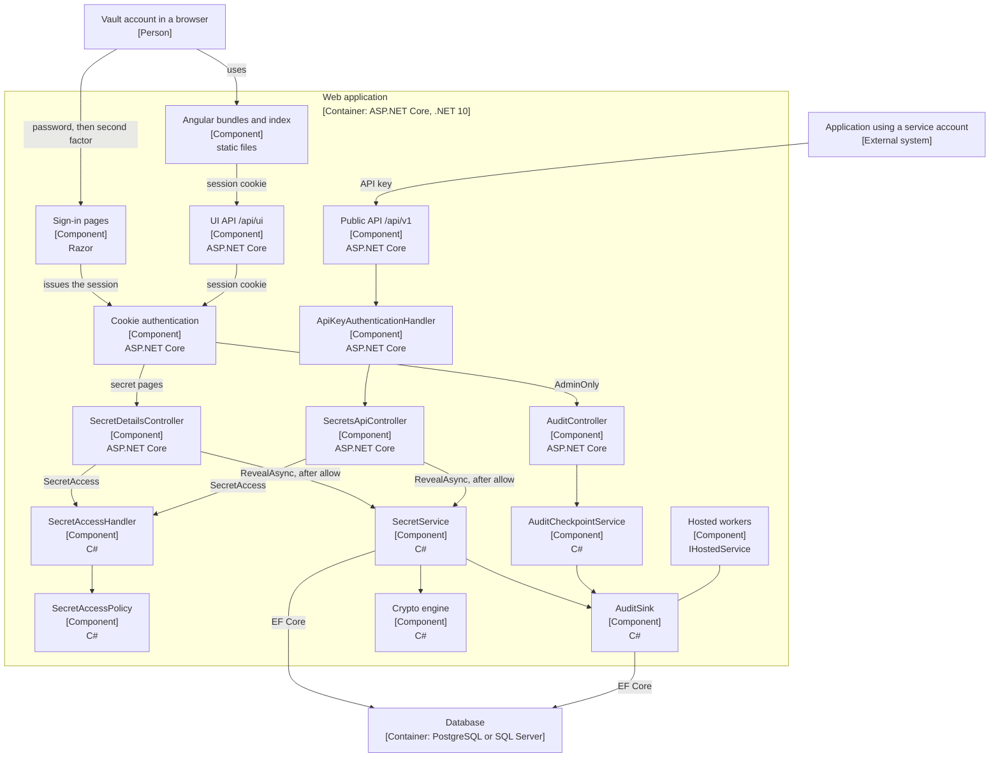
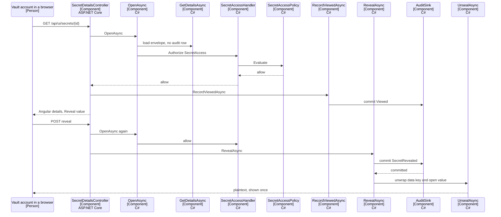

# Diagrams / დიაგრამები

These are C4 views of `origin/main` at `d576dd93a30bc461183ca7b71c89f038adbff446`
(21 November 2026, 22:42 Asia/Tbilisi). Every box names its C4 type in brackets.
A container box is `[Container: technology]` plus a short technology line. A component box is
`[Component]` plus a short technology line. People, the software system, and external systems carry
the type only.

The Angular UI is a container that runs in the browser; section 2 draws it. Core and
Infrastructure are components inside the Web application, drawn in section 3, not containers of
their own. Node and the .NET SDK build the image and are not runtime containers; section 5 names
them and does not draw them. The database and Redis are runtime containers in section 2, not in
the context picture.

The rendered pages are [diagrams.html](diagrams.html) and the files in [svg/](svg/). Regenerate
them with `npm run render` in [render/](render/).

## 1. Context

Who is outside the vault. EclipsVault is one software system in the centre. The database and Redis
are inside that system, so they are not drawn here.

Caption / წარწერა: EclipsVault is one software system. A vault account in a browser is a person and
uses a session. An application that uses a service account is an external system and calls the
Public API with an API key. The identity provider, SMTP, and Vault Transit exist only when that
integration is configured. / EclipsVault ერთი პროგრამული სისტემაა. ბრაუზერში მყოფი საცავის
ანგარიში პიროვნებაა და სესიას იყენებს. აპლიკაცია, რომელიც სერვისის ანგარიშს იყენებს, გარე
სისტემაა და საჯარო API-ს API გასაღებით იძახებს. იდენტობის მომწოდებელი, SMTP და Vault Transit
მხოლოდ მაშინ არსებობენ, როცა ეს ინტეგრაცია კონფიგურირებულია.

| Element | Source at `d576dd9` |
|---|---|
| Vault account in a browser `[Person]` | `CONTEXT.md` vault account, session, second factor |
| Application using a service account `[External system]` | `CONTEXT.md`: a service account is a non-interactive identity for an application. It never has a session |
| EclipsVault `[Software System]` | ADR-0008: one origin, one process serves the UI and both APIs |
| Session-cookie edge | ADR-0002; `Program.cs` cookie `EclipsVault.Session` |
| Person to the system | `AccountController.Login` then `SessionIssuer.SignInAsync`. Sign-in pages are still Razor |
| That application to the Public API | `SecretsApiController` route `api/v1/secrets`; `ApiKeyAuthenticationHandler` |
| Identity provider `[External system]`, when enabled | `Program.cs` wires OpenID Connect only when `SsoOptions.Enabled`; ADR-0002: the IdP proves identity and the vault decides admission |
| SMTP server `[External system]`, when selected | `DependencyInjection` uses `SmtpEmailSender` only when `Email:Sender` is `Smtp`; committed default in `appsettings.json` is `Log` |
| Vault Transit `[External system]`, when selected | `appsettings.json` `Crypto:Engine` is `AesGcmLocal`; `VaultTransitCryptoEngine` is used when the engine is `VaultTransit` |
| Angular UI, not a second software system | ADR-0008: Web serves it from the same origin. It is a container inside this system, drawn in section 2 |
| Database and Redis | Drawn in section 2. `DependencyInjection` selects one `Database:Provider`. `appsettings.json` sets `Redis:Enabled` false |

## 2. Container

Runtime containers inside the one software system. The people and external systems from section 1
stay outside the boundary. Image-build stages are not runtime containers; section 5 names them and
does not draw them. Core, Infrastructure, the remaining Razor sign-in pages, and the hosted workers
are components of the Web application; section 3 draws those.

Caption / წარწერა: The Angular UI, the Web application, and one database are runtime containers.
Redis is a fourth container only when it is enabled. The Angular UI runs in the browser and calls
the UI API with the session cookie. The Web application serves the Angular files, the UI API, the
Public API, and the Razor sign-in pages that remain. The person and the external systems stay
outside the boundary. / Angular UI, Web აპლიკაცია და ერთი ბაზა გაშვების კონტეინერებია. Redis
მეოთხე კონტეინერია მხოლოდ მაშინ, როცა ჩართულია. Angular UI ბრაუზერში ეშვება და UI API-ს სესიის
ქუქით იძახებს. Web აპლიკაცია Angular-ის ფაილებს, UI API-ს, საჯარო API-ს და დარჩენილ Razor-ის
შესვლის გვერდებს აწვდის. პიროვნება და გარე სისტემები საზღვრის გარეთ რჩებიან.

| Element | Source at `d576dd9` |
|---|---|
| Vault account in a browser `[Person]` | `CONTEXT.md` vault account; outside the system boundary |
| Application using a service account `[External system]` | `CONTEXT.md` service account; outside the system boundary |
| Identity provider, SMTP server, Vault Transit | Same configuration gates as section 1. Each arrow leaves the Web application and ends at that external system |
| EclipsVault `[Software System]` boundary | ADR-0008: one system, one origin |
| Angular UI `[Container: Angular, runs in the browser]` | ADR-0008 and `Dockerfile` `ui` stage: the built files run in the browser. `AngularUiRoutes` and `HomeController.Index` serve the document from Web |
| Arrow from Angular UI to Web, session cookie and UI API | ADR-0002; ADR-0005; `Program.cs` cookie `EclipsVault.Session` |
| Web application `[Container: ASP.NET Core, .NET 10]` | `Dockerfile` runtime stage, `ENTRYPOINT` `EclipsVault.Web.dll`. It serves the Angular files, `/api/ui/`, `/api/v1/`, and the Razor paths absent from `AngularUiRoutes` |
| Database `[Container: PostgreSQL or SQL Server]` | `DependencyInjection` reads `Database:Provider` once; `DatabaseProvider.UseVaultDatabase` |
| Redis `[Container: Redis]`, when enabled | `appsettings.json` `Redis:Enabled` false; `DependencyInjection` registers Redis implementations only when it is true |
| Core, Infrastructure, sign-in pages, hosted workers | Not boxes here. Section 3 draws them inside the Web application |
| Node and .NET SDK build stages | Not boxes here. `Dockerfile` stages `ui` and `build`. Section 5 records them as image build, not runtime |

## 3. Web component

Components inside the Web application container from section 2. The vault account reaches the
Angular files and the UI API from outside, and the Razor sign-in pages before a session exists.
An application that uses a service account is the only caller of the Public API. The database
stays outside the boundary. SecretService and AuditSink reach it through EF Core. Controllers stay
thin; the access rule lives in Core.

Caption / წარწერა: The vault account loads the Angular files. Those pages call the UI API with the
session cookie. Secret details, the audit log, and Encryption keys are Angular routes.
`SecretDetailsController` asks `SecretAccessHandler`, records `Viewed` only after allow, and calls
`RevealAsync` only after a later allow. The Public API reaches `SecretsApiController` through the
API key handler and uses the same policy. Sign-in is still the Razor pages. `AuditController` is
the audit log and is `AdminOnly`. SecretService and AuditSink persist through EF Core. /
საცავის ანგარიში Angular-ის ფაილებს ტვირთავს. ეს გვერდები UI API-ს სესიის ქუქით იძახებენ.
საიდუმლოს დეტალები, აუდიტის ჟურნალი და Encryption keys Angular-ის მარშრუტებია.
`SecretDetailsController` ეკითხება `SecretAccessHandler`-ს, `Viewed`-ს მხოლოდ ნებართვის შემდეგ
წერს და `RevealAsync`-ს მხოლოდ მომდევნო ნებართვის შემდეგ იძახებს. საჯარო API
`SecretsApiController`-ს API გასაღების დამმუშავებლით აღწევს და იმავე წესს იყენებს. შესვლა ჯერ
Razor-ის გვერდებია. `AuditController` აუდიტის ჟურნალია და `AdminOnly`-ა. SecretService და
AuditSink მონაცემებს EF Core-ით წერენ.

| Element | Source at `d576dd9` |
|---|---|
| Vault account in a browser `[Person]` | `CONTEXT.md` vault account; ADR-0002: the browser holds the session cookie and no access token |
| Angular bundles and index `[Component]` | `AngularUiRoutes`: document outside `wwwroot`, bundles under `wwwroot/ui`. `HomeController.Index` serves the same document for `/` once a session exists |
| Route table | `AngularUiRoutes.Paths` includes `/Secrets`, `/Secrets/Details/{id}`, `/DynamicSecrets`, `/Account/Denied`. `administratorPaths` includes `/Audit` and `/Encryption` |
| Sign-in pages `[Component]` | `Views/Account/Login.cshtml`, `Totp.cshtml`, `EnrollTotp.cshtml`, `Recover.cshtml`, `RecoveryCode.cshtml`. These paths are absent from `AngularUiRoutes` |
| UI API and Public API `[Component]` | ADR-0005: neither accepts the other's credential |
| UI API problem responses | ADR-0006; `Program.cs` `MapFallback("/api/ui/{**path}")` |
| Cookie authentication `[Component]` | `Program.cs` `EclipsVault.Session`, `EclipsVault.MfaPending`, `HttpOnly`, `Secure`, `SameSite=Strict` |
| `ApiKeyAuthenticationHandler` `[Component]` | `ApiKeyAuthenticationHandler` |
| `SecretDetailsController` `[Component]` | `SecretDetailsController` on `api/ui/secrets/{id}`. `OpenAsync` loads details, then `VaultPolicies.SecretAccess`. `Get` calls `RecordViewedAsync` only after allow. `Reveal` calls `RevealAsync` only after allow and, when required, step-up |
| `SecretsApiController` to handler, then `RevealAsync` | `SecretsApiController.Get` on `api/v1/secrets/{id}` asks `SecretAccess`, records `SecretAccessDenied` on refusal, and calls `RevealAsync` after allow |
| `SecretAccessHandler` and `SecretAccessPolicy` `[Component]` | `SecretAccessHandler` delegates to `SecretAccessPolicy.Evaluate`, which answers allow or deny and does not call `SecretService` |
| `SecretService` `[Component]` | `SecretService`. `GetDetailsAsync` writes no audit row. `RevealAsync` commits `SecretRevealed` before `DecryptToDtoAsync` |
| UI secrets list, not drawn | `SecretsController` on `api/ui/secrets`. The comment on the class: the list writes no audit row and shows only rows the caller could open |
| `AuditSink` `[Component]` | `AuditSink`; `AuditGroupCommitter` |
| `AuditCheckpointService` `[Component]` | `AuditCheckpointService.VerifyAsync` and `ExportAsync`; `AuditChainVerifier.VerifyAsync` |
| `AuditController` `[Component]` | `AuditController` on `api/ui/audit`, `VaultPolicies.AdminOnly`. `Get` writes `AuditLogViewed` before listing |
| Crypto engine `[Component]` | `CryptoEngineFactory`; `AesGcmCryptoEngine`; `VaultTransitCryptoEngine`. `IKekRotationService` is `KekRotationService`, reached from `EncryptionController` |
| Hosted workers `[Component]` | `Program.cs` registers `SecretLifecycleWorker`, `DynamicLeaseWorker`, and `LicenseStartupCheck`; `DependencyInjection` hosts `AuditGroupCommitter`. Threads in the Web application, not containers |
| Server decides what the UI may show | ADR-0012 |
| Database `[Container: PostgreSQL or SQL Server]`, outside Web | `DependencyInjection` `AddDbContext`; `DatabaseProvider.UseVaultDatabase` |
| SecretService and AuditSink to the database, EF Core | `SecretService` writes through its repository; `AuditSink` commits through `AuditGroupCommitter`. Both use the EF Core `EclipsVaultDbContext`. `AuditSaveChangesInterceptor` stamps every audit insert into the hash chain |

## 4. Focused code: reveal

Success path for an Internal secret that does not need step-up. This is the talk's secret. Each
participant is a component of that path, except the vault account, which is the person. In a
sequence diagram `#` starts a comment, so the technology line is written `C#35;`, which renders
as `C#`.

Caption / წარწერა: Opening the details page checks access before it commits `Viewed`. Reveal
checks access again, commits `SecretRevealed`, and only then calls `UnsealAsync`. The Angular page
shows the plaintext once. / დეტალების გვერდის გახსნა წვდომას `Viewed`-ის დაფიქსირებამდე ამოწმებს.
გახსნა წვდომას თავიდან ამოწმებს, აფიქსირებს `SecretRevealed`-ს და მხოლოდ შემდეგ იძახებს
`UnsealAsync`-ს. Angular-ის გვერდი ღია ტექსტს ერთხელ აჩვენებს.

| Element | Source at `d576dd9` |
|---|---|
| Vault account in a browser `[Person]` | `CONTEXT.md` vault account. The page is `secret-details-page`, route `/Secrets/Details/{id}` |
| `SecretDetailsController` `[Component]` | `SecretDetailsController.Get` and `Reveal` |
| `OpenAsync` `[Component]` | `SecretDetailsController.OpenAsync` calls `GetDetailsAsync`, then `IAuthorizationService.AuthorizeAsync` with `VaultPolicies.SecretAccess` |
| `GetDetailsAsync` `[Component]` | `SecretService.GetDetailsAsync` loads the envelope and trips a honey-token if the row is one. It writes no audit row. ADR-0031 |
| `RecordViewedAsync` `[Component]` | `SecretService.RecordViewedAsync` writes `SecretMetadataViewed`, and only from `Get` after allow |
| Label `Viewed` | `AuditDisplay` for `AuditAction.SecretMetadataViewed` |
| Denial writes `SecretAccessDenied` and does not reveal | `OpenAsync` calls `RecordAccessDeniedAsync` and returns 403 `access_denied`. `Reveal` is not called |
| Step-up skipped below Secret | `appsettings.json` `StepUp:MinimumSensitivity` `Secret`; `SecretDetailsController.StepUpRequiredAsync` |
| `RevealAsync` then `AuditSink` `[Component]` | `SecretService.RevealAsync` awaits `AuditSecretAsync` for `SecretRevealed` before `DecryptToDtoAsync` |
| Sink waits for commit | `AuditSink` throws `AuditWriteFailedException` rather than returning an unaudited success |
| `UnsealAsync` `[Component]` | `AesGcmCryptoEngine.UnsealAsync` unwraps the data key with the master key, then opens the payload. `DecryptToDtoAsync` zeroes the buffer |
| Screen label `Revealed` | `AuditDisplay` for `AuditAction.SecretRevealed` |
| Plaintext on the Angular page, once | `secret-details-page.html`: "The value is shown once — reload to hide it." Do not record that screen |

Honey-token trips are not in this sequence. `GetDetailsAsync` and `RevealAsync` call
`TripHoneyTokenIfNeededAsync` before any audit write on that path. The talk never uses that path.
The decoy names are in the demo draft so they can be avoided.

## 5. Deployment

Two places the section 2 containers run. Each place is a deployment node. The containers sit
inside the node where they run. The Angular UI runs in a browser. In Development the Web
application runs on the developer machine, and the database runs in a Compose project on Docker.
In production a TLS reverse proxy stands in front of the Web image, and the database has its own
server. The talk's demonstration is a disposable Development run, not a third deployment. The
Dockerfile's Node stage and .NET SDK stage build the image and are not boxes here.

```mermaid
%%{init: {"flowchart": {"wrappingWidth": 560}} }%%
flowchart TB
  subgraph development ["Development<br/>[Deployment node]"]
    subgraph browserDev ["Developer browser<br/>[Deployment node]"]
      angularDev["Angular UI<br/>[Container: Angular, runs in the browser]"]
    end
    subgraph machine ["Developer machine<br/>[Deployment node]"]
      webDev["Web application<br/>[Container: ASP.NET Core, .NET 10]"]
      subgraph dockerDev ["Docker host<br/>[Deployment node: Docker Engine]"]
        subgraph compose ["Compose project<br/>[Deployment node: Docker Compose]"]
          dbDev["Database<br/>[Container: PostgreSQL]"]
          redisDev["Redis<br/>[Container: Redis]<br/>when enabled"]
        end
      end
    end
  end
  subgraph production ["Production<br/>[Deployment node]"]
    subgraph browserProd ["Browser<br/>[Deployment node]"]
      angularProd["Angular UI<br/>[Container: Angular, runs in the browser]"]
    end
    proxy["TLS reverse proxy<br/>[Deployment node]"]
    subgraph appHost ["Application host<br/>[Deployment node: Docker Engine]"]
      webProd["Web application<br/>[Container: ASP.NET Core, .NET 10]"]
    end
    subgraph redisHost ["Redis host<br/>[Deployment node]<br/>when enabled"]
      redisProd["Redis<br/>[Container: Redis]"]
    end
    subgraph dbSrv ["Database server<br/>[Deployment node]"]
      dbProd["Database<br/>[Container: PostgreSQL or SQL Server]"]
    end
  end
  angularDev -->|session cookie, UI API| webDev
  webDev -->|one provider| dbDev
  webDev -.->|when enabled| redisDev
  angularProd -->|session cookie, UI API| proxy
  proxy -->|plain HTTP| webProd
  webProd -->|one provider| dbProd
  webProd -.->|when enabled| redisProd
```

Caption / წარწერა: Development and production are deployment nodes. Development runs Web on the
developer machine and PostgreSQL in the Compose project, because that project's `db` service is
PostgreSQL. Production runs the Web image on a Docker host behind a TLS reverse proxy, and its
database node may be PostgreSQL or SQL Server. The demonstration is one disposable Development
run, not another deployment. / Development და production განთავსების კვანძებია. Development Web-ს
დეველოპერის მანქანაზე უშვებს, PostgreSQL-ს კი Compose პროექტში, რადგან ამ პროექტის `db` სერვისი
PostgreSQL-ია. Production Web იმიჯს Docker ჰოსტზე უშვებს TLS შებრუნებული პროქსის უკან, და მისი
ბაზის კვანძი შეიძლება იყოს PostgreSQL ან SQL Server. დემონსტრაცია Development-ის ერთი ერთჯერადი
გაშვებაა, არა სხვა განთავსება.

| Element | Source at `d576dd9` |
|---|---|
| Developer browser `[Deployment node]` and Angular UI container | ADR-0008: the Angular UI runs in the browser. Same container as section 2 |
| Developer machine `[Deployment node]` and Web application container | `README.md` `dotnet run --project EclipsVault.Web`. Web is not a compose service; ADR-0008 |
| Docker host `[Deployment node: Docker Engine]` | `docker-compose.yml` header: laptop, loopback ports, not a deployment of Web |
| Compose project `[Deployment node: Docker Compose]` | `docker-compose.yml` services `db` and `redis`. Also starts `vault`, `mailpit`, and `keycloak`, which this picture does not draw. Present does not mean the process uses them |
| Development database `[Container: PostgreSQL]` | Compose service `db` is PostgreSQL only. SQL Server is not started by this Compose file |
| Development Redis container, when enabled | Compose service `redis`; `appsettings.json` `Redis:Enabled` false |
| TLS reverse proxy `[Deployment node]` | `docs/INSTALL.md`: TLS terminates at the proxy; the image serves plain HTTP on 8080 |
| Application host `[Deployment node: Docker Engine]` and Web application container | `Dockerfile` runtime stage, `ASPNETCORE_HTTP_PORTS=8080`; `docs/INSTALL.md` |
| Redis host `[Deployment node]`, when enabled | `docs/INSTALL.md` treats Redis as optional configuration, not part of the Web image |
| Database server `[Deployment node]` and database container | `docs/INSTALL.md` section 2: least-privilege login, TLS on the connection. Values are the operator's, not in this draft |
| Demonstration, not a third deployment | [demo-setup-reset.md](demo-setup-reset.md): one disposable Development run on this revision |
| Node image-build stage, not drawn | `Dockerfile` `AS ui`, `npm run build` |
| .NET SDK image-build stage, not drawn | `Dockerfile` `AS build`, `dotnet publish` |
| Production bootstraps one administrator and no sample secrets | `DbSeeder` production path; `DbSeederTests` names that behaviour |
| Production does not migrate unless `Database:MigrateOnStartup` | `DatabaseMigrator`; `docs/INSTALL.md` |
| Production provider, connection, KEK, audit signing key, key ring | `docs/INSTALL.md` section 2. Values are the operator's, not in this draft |
| Browser end-to-end stack | `AGENTS.md` browser section: production image, SQL Server, Redis, SMTP capture, TLS proxy. A test harness, not the talk and not production |

The end-to-end harness is omitted. It is a Playwright shape, not Development and not production.
